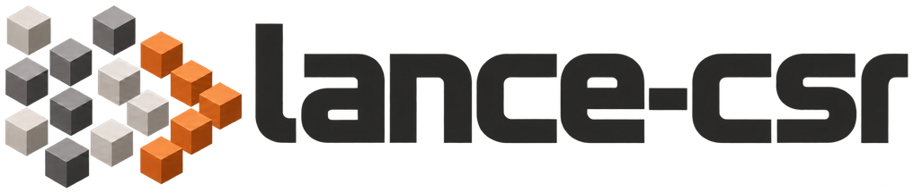

<h1>
  <picture>
    <source media="(prefers-color-scheme: dark)" srcset="docs/assets/brand/desktop-dark-1016.png">
    <source media="(prefers-color-scheme: light)" srcset="docs/assets/brand/desktop-light-1016.png">
    
  </picture>
</h1>

**Fast graph queries on Lance**

[](https://github.com/hyperdimensionalcomputingai/lance-csr/actions/workflows/rust-test.yml)
[](https://github.com/hyperdimensionalcomputingai/lance-csr/actions/workflows/python-test.yml)
[](https://pypi.org/project/lance-csr/)
[](LICENSE)

[Documentation](https://lance-csr.hdclabs.ai/) · [Examples](examples/README.md) ·
[Releases](https://github.com/hyperdimensionalcomputingai/lance-csr/releases) · [Contributing](CONTRIBUTING.md)

lance-csr is a fast graph query engine over [Lance](https://lancedb.github.io/lance/) datasets, built in Rust on
Apache DataFusion, with Python bindings. It is a fork of [lance-graph](https://github.com/lance-format/lance-graph)
and a research test bed: it pushes the limits of CSR indexes and DataFusion on top of the Lance format, with the
goal of making multi-hop path traversal fast.

**Documentation:** Visit the [lance-csr documentation site](https://lance-csr.hdclabs.ai/) for getting started,
Cypher guides, the CSR index, the Python API reference, and benchmarks.

## Goals

lance-csr is built for single-machine execution. It aims to:

- **Provide a fast, lightweight and portable query engine.** An openCypher-compatible engine on top of the Lance
  format that runs on one machine, inside your process, with no server to operate.
- **Enable multimodal knowledge graphs.** Lance stores images, video, audio and other media alongside vectors and
  structured columns. lance-csr runs fast path traversal queries over those same datasets, so a knowledge graph
  works on a single copy of the data instead of a second copy in a separate graph database.
- **Push the limits of DataFusion for graph traversal.** We want to find out how far DataFusion's execution engine
  can go in powering multi-hop graph traversal, an area with little open-source work so far.

### Out of scope: distributed execution

Graph queries across multiple machines are **explicitly out of scope** for this repository, to keep it free of
complexity that works against the goals above. **Issues and pull requests that target distributed execution will
be closed as out of scope.**

If your use case involves distributed graph query processing or graph algorithms, that is exactly the kind of
engine we're building at HDC Labs. [Reach out to us](https://hyperdimensionalcomputing.ai/contact/) to chat more.

## Why a CSR

lance-graph runs each relationship hop as a join between the edge and node tables. A multi-hop query repeats that
join at every hop, building a hash table and materializing every intermediate path each time.
[Compressed sparse row (CSR)](https://en.wikipedia.org/wiki/Sparse_matrix#Compressed_sparse_row_(CSR,_CRS_or_Yale_format))
is the standard compact layout for a sparse matrix, and so for a graph's adjacency: an offsets array indexed by node
points into one array of neighbor ids, so each node's neighbors sit next to each other. Expanding a hop becomes an
array lookup per node instead of a join. lance-csr builds this index from the relationship tables and runs it inside
DataFusion as extension operators, falling back to a join for any hop the CSR can't express.

## What this fork adds

- **CSR traversal** (`use_csr=True`) for single hops and variable-length paths, directed or undirected, updated
  incrementally when the underlying Lance datasets change.
- **A Lance-native engine** that keeps each table either on disk (read lazily from a Lance snapshot) or in memory,
  and `refresh()`es to new dataset versions.
- **Smarter planning**: patterns start at their most selective node, and DataFusion gets column statistics to size
  its joins.
- **Much wider Cypher**. The Graph Data Council (GDC), formerly known as the Linked Data Benchmark Council (LDBC),
  maintains the official Interactive complex queries. lance-csr runs them (IC14 without `reduce()`, which
  openCypher leaves out), with `OPTIONAL MATCH`, `EXISTS` and pattern predicates, chained `WITH`, `UNWIND`,
  list and pattern comprehensions, maps, relationship alternation, `shortestPath`, `$parameters` and more,
  following openCypher's
  [standardisation scope](https://github.com/opencypher/openCypher/blob/master/docs/standardisation-scope.adoc).
- **Correctness fixes** to behavior inherited from lance-graph (for example, undirected patterns dropped incoming
  edges), each with a regression test.
- **Current dependencies** (Lance 13, DataFusion 54, Arrow 58, PyO3 0.28), with Delta Lake and Unity Catalog support
  removed.

## Repository layout

- `crates/lance-csr` – the Cypher-capable query engine implemented in Rust
- `python/` – PyO3 bindings and Python packages:
  - `lance_csr` – thin wrapper around the Rust query engine

See [`docs/project_structure.md`](docs/project_structure.md) for the full workspace layout.

## Install

```bash
uv add lance-csr
```

Prebuilt wheels cover Linux x86-64 and native Apple Silicon (CPython 3.12+); no Rust toolchain is needed.
See [`python/README.md`](python/README.md) for details and usage.

To use the engine from Rust, add the crate with `cargo add lance-csr` and see
[`crates/lance-csr/README.md`](crates/lance-csr/README.md) and the
[Rust guide](https://lance-csr.hdclabs.ai/rust/).

## Build from source

You need:

- Rust, through [rustup](https://rustup.rs): `rust-toolchain.toml` pins the version, and rustup installs it on the
  first build.
- `protoc`, which Lance's build needs: `brew install protobuf` on macOS, or
  `sudo apt-get install -y protobuf-compiler` on Debian and Ubuntu.
- Python 3.12 or newer, and [`uv`](https://docs.astral.sh/uv/).

Rust crates, from the repository root:

```bash
cargo test --workspace
cargo clippy --workspace --all-targets -- -D warnings
cargo fmt --all --check
```

Python package, from `python/`. `uv sync --locked` installs the exact dependency versions in `uv.lock`,
including the development tools (maturin, pytest, ruff, pyright), into `python/.venv`:

```bash
cd python
uv sync --locked --no-install-project   # locked dependencies and dev tools
uv run --no-sync maturin develop        # debug build of the extension into .venv
uv run --no-sync pytest python/tests    # run the tests
```

`--no-install-project` leaves the package itself to `maturin develop`, which makes a debug build that compiles
quickly; uv would otherwise build it in release mode. `--no-sync` stops `uv run` from re-syncing, which would remove
that build. Re-run `maturin develop` after changing Rust code. `make install`, `make test` and `make lint` wrap
these steps. For timing queries, build with `maturin develop --release`: release builds use thin LTO and take
several minutes. See [`python/DEVELOPMENT.md`](python/DEVELOPMENT.md) for more.

## Python example: Cypher query

```python
import pyarrow as pa
from lance_csr import CypherQuery, GraphConfig

people = pa.table({
    "person_id": [1, 2, 3, 4],
    "name": ["Alice", "Bob", "Carol", "David"],
    "age": [28, 34, 29, 42],
})

config = (
    GraphConfig.builder()
    .node_table("Person", "person_id")
    .build()
)

query = (
    CypherQuery("MATCH (p:Person) WHERE p.age > 30 RETURN p.name AS name, p.age AS age")
    .with_config(config)
)
result = query.execute({"Person": people})
print(result.to_pydict())  # {'name': ['Bob', 'David'], 'age': [34, 42]}
```

## Python example: Direct SQL query

For data analytics workflows where you prefer standard SQL, use `SqlQuery` or `SqlEngine`. No `GraphConfig` is needed:

```python
import pyarrow as pa
from lance_csr import SqlQuery, SqlEngine

person = pa.table({
    "id": [1, 2, 3],
    "name": ["Alice", "Bob", "Carol"],
    "age": [28, 34, 29],
})

# One-off query
result = SqlQuery(
    "SELECT name, age FROM person WHERE age > 30"
).execute({"person": person})
print(result.to_pydict())  # {'name': ['Bob'], 'age': [34]}

# Multi-query with cached context
engine = SqlEngine({"person": person})
r1 = engine.execute("SELECT COUNT(*) AS cnt FROM person")
r2 = engine.execute("SELECT name FROM person ORDER BY age DESC LIMIT 2")
```

## Benchmarks

The benchmark runners and raw results live in two sibling repositories, next to the other engines' runners, so
every number below can be reproduced from there. These are independent, unaudited measurements, not GDC Benchmark
Results. lance-csr runs with the CSR (`use_csr=True`) in two modes: *in memory* holds every table as Arrow in
memory, and *lazy* reads Lance datasets from disk as queries need them. Neo4j runs as a server in a Docker VM; the
other engines run embedded in the Python process. `docs/sync_benchmarks.py` regenerates the tables from the
repositories' committed results.

<a id="ldbc-snb-interactive-complex-queries"></a>

### GDC SNB Interactive complex queries

[GDC Interactive benchmark repository](https://github.com/hyperdimensionalcomputingai/graph-benchmark-ldbc-complex) runs the
14 complex read queries (IC1–IC14) of the GDC SNB Interactive v1 workload over the SF1 dataset, with one fixed
parameter set per query and every result checked against a golden answer. lance-csr's
[runner](https://github.com/hyperdimensionalcomputingai/graph-benchmark-ldbc-complex/tree/main/lance_csr) runs
Neo4j's Cypher text for IC1–IC13 unchanged; IC14 replaces `reduce()`, which openCypher leaves out, with pattern
comprehensions.

Over the 14 queries, lance-csr's speed relative to each engine:

<!-- bench:ic:summary -->

| lance-csr mode | vs Neo4j | vs Kuzu | vs Ladybug |
| --- | ---: | ---: | ---: |
| In memory | 3.9× faster | 6.1× faster | 3.2× faster |
| Lazy (Lance on disk) | 1.8× faster | 2.8× faster | 1.3× faster |

<!-- /bench:ic:summary -->

Mean query latency in milliseconds (lower is better, fastest per query in bold):

<!-- bench:ic:table -->

| Query | lance-csr 0.3.1, in memory | lance-csr 0.3.1, lazy | Neo4j 2026.09.0 | Kuzu 0.11.3 | Ladybug 0.21.2 |
| --- | ---: | ---: | ---: | ---: | ---: |
| IC1 | 26.23 | 32.17 | 51.39 | **13.51** | n/a |
| IC2 | **2.74** | 26.18 | 44.73 | 24.97 | 15.56 |
| IC3 | **59.31** | 424.82 | 894.91 | 105.21 | 100.16 |
| IC4 | **5.94** | 13.44 | 13.05 | 29.66 | 11.83 |
| IC5 | **81.50** | 106.39 | 1,022.62 | 747.75 | 309.02 |
| IC6 | **24.68** | 27.14 | 231.25 | 1,114.76 | 234.21 |
| IC7 | 20.74 | 32.28 | **7.14** | 453.74 | 370.55 |
| IC8 | **2.04** | 3.06 | 3.00 | 73.44 | 4.95 |
| IC9 | **41.78** | 825.02 | 802.28 | 130.96 | 62.14 |
| IC10 | 100.21 | 136.60 | 91.68 | 74.90 | **13.69** |
| IC11 | 3.73 | 6.05 | 11.02 | 4.71 | **2.51** |
| IC12 | **19.77** | 26.75 | 133.87 | 92.26 | 133.84 |
| IC13 | 1.11 | 1.45 | **0.92** | 14.16 | 47.55 |
| IC14 | **46.80** | 47.88 | 522.56 | 1,871.19 | n/a |

<!-- /bench:ic:table -->

<!-- bench:ic:notes -->

- Run on Apple M5, 24 GB, macOS 26.6.2, from the benchmark repository at commit [`f3e63fd`](https://github.com/hyperdimensionalcomputingai/graph-benchmark-ldbc-complex/tree/f3e63fd2b7239a1364a864458f3e7ae07f0d833f). lance-csr was measured on 2026-10-27 and the other engines on 2026-10-24, on the same machine, with the repository's `run_benchmarks.sh` settings; see its README to reproduce the runs.
- Ratios are geometric means of the per-query ratios, over the queries both engines answered correctly.
- Ladybug 0.21.2: IC1 returned a wrong answer; IC14 failed (RuntimeError), so they are not timed.

<!-- /bench:ic:notes -->

<a id="ldbc-snb-sf1-30-query-workload"></a>

### GDC SNB SF1, 30-query workload

[GDC SF1 benchmark repository](https://github.com/hyperdimensionalcomputingai/graph-benchmark-ldbc) runs 30 custom Cypher
queries over the GDC SNB SF1 dataset (3.18M nodes, 17.3M relationships), with every result checked against an
expected answer. lance-csr's [runner](https://github.com/hyperdimensionalcomputingai/graph-benchmark-ldbc/tree/main/lance_csr)
runs the same query text and Lance datasets as the lance-graph runner.

Over the 30 queries, lance-csr's speed relative to each engine:

<!-- bench:q30:summary -->

| lance-csr mode | vs Neo4j | vs Kuzu | vs Ladybug | vs lance-graph |
| --- | ---: | ---: | ---: | ---: |
| In memory | 3.6× faster | 4.1× faster | 2.6× faster | 4.6× faster |
| Lazy (Lance on disk) | 2.1× faster | 2.3× faster | 1.5× faster | 2.6× faster |

<!-- /bench:q30:summary -->

Mean query latency in milliseconds (lower is better, fastest per query in bold):

<!-- bench:q30:table -->

| Query | lance-csr 0.3.1, in memory | lance-csr 0.3.1, lazy | Neo4j 2026.09.0 | Kuzu 0.11.3 | Ladybug 0.21.2 | lance-graph 0.5.4 |
| --- | ---: | ---: | ---: | ---: | ---: | ---: |
| Q1 | **0.66** | 1.13 | 1.28 | 1.73 | 1.22 | 1.30 |
| Q2 | **0.51** | 1.33 | 3.26 | 1.32 | 1.12 | 2.34 |
| Q3 | **0.62** | 0.77 | 0.66 | 1.03 | 0.79 | 1.86 |
| Q4 | 0.48 | 0.75 | 2.66 | 0.85 | **0.39** | 2.98 |
| Q5 | **0.77** | 2.23 | 2.78 | 3.44 | 4.00 | 2.04 |
| Q6 | **0.41** | 0.71 | 2.60 | 0.66 | 0.79 | 0.73 |
| Q7 | 0.98 | 1.05 | **0.43** | 27.73 | 25.11 | 15.68 |
| Q8 | **0.61** | 1.75 | 7.29 | 2.72 | 3.38 | 1.14 |
| Q9 | 0.81 | 1.32 | **0.76** | 1.73 | 1.34 | 1.89 |
| Q10 | **0.70** | 0.91 | 3.79 | 1.55 | 1.78 | 26.69 |
| Q11 | **1.47** | 1.89 | 10.28 | 7.96 | 4.63 | 3.08 |
| Q12 | **0.69** | 6.80 | 2.55 | 17.16 | 7.84 | 18.68 |
| Q13 | **0.74** | 0.99 | 6.65 | 42.66 | 5.84 | 9.62 |
| Q14 | 0.48 | 0.65 | **0.46** | 1.56 | 0.90 | 2.91 |
| Q15 | **0.51** | 0.70 | 2.37 | 2.38 | 1.16 | 3.02 |
| Q16 | **0.62** | 1.06 | 1.26 | 1.78 | 1.04 | 4.33 |
| Q17 | **0.87** | 1.37 | 3.09 | 2.62 | 1.74 | 2.30 |
| Q18 | **0.63** | 1.07 | 3.11 | 1.51 | 1.22 | 1.76 |
| Q19 | **0.90** | 1.33 | 4.86 | 11.66 | 3.43 | 19.93 |
| Q20 | **2.05** | 16.45 | 421.92 | 13.25 | 14.15 | 3.13 |
| Q21 | 0.70 | 0.79 | 0.51 | **0.44** | 0.50 | 1.46 |
| Q22 | **0.65** | 0.88 | 2.66 | 23.34 | 7.46 | 13.41 |
| Q23 | **0.66** | 1.18 | 3.13 | 1.19 | 0.79 | 2.42 |
| Q24 | **0.63** | 1.00 | 0.72 | 1.23 | 0.81 | 1.75 |
| Q25 | **0.72** | 1.13 | 2.86 | 1.45 | 1.27 | 1.47 |
| Q26 | 0.67 | 1.02 | **0.65** | 3.37 | 1.15 | 2.93 |
| Q27 | **0.80** | 1.24 | 2.22 | 17.96 | 3.71 | 24.84 |
| Q28 | **1.36** | 2.25 | 2.37 | 1.51 | 1.78 | 2.50 |
| Q29 | **0.62** | 0.97 | 2.62 | 1.02 | 0.72 | 2.96 |
| Q30 | 43.67 | 47.50 | 1,359.98 | 146.52 | 97.77 | **34.31** |

<!-- /bench:q30:table -->

<!-- bench:q30:notes -->

- Run on Apple M5, 24 GB, macOS 26.6.2, from the benchmark repository at commit [`b649bc1`](https://github.com/hyperdimensionalcomputingai/graph-benchmark-ldbc/tree/b649bc166cb5a04a542882fc070d9c4d83507c65). lance-csr was measured on 2026-10-27 and the other engines on 2026-10-24, on the same machine, with the repository's `run_benchmarks.sh` settings; see its README to reproduce the runs.
- Ratios are geometric means of the per-query ratios, over the queries both engines answered correctly.

<!-- /bench:q30:notes -->

## Contributing

Contributions within the [project's goals](#goals) are welcome, from people and from their coding agents. Every
pull request should explain the problem it solves and why the change is needed, and back that up with evidence:
a regression test for a bug fix, and before-and-after results from both benchmark suites for a code change.
[`CONTRIBUTING.md`](CONTRIBUTING.md) explains what to include and how to build the benchmark harness that
measures your branch against `main`. If you're unsure whether an idea fits, open an issue to discuss it first.

## Credits

lance-csr builds on the work of two open-source projects:

- The maintainers and contributors of [lance-graph](https://github.com/lance-format/lance-graph), who built the
  foundation lance-csr stands on: the Cypher parser, semantic analysis, the DataFusion planner, the graph
  configuration and the Python bindings. See [`NOTICE`](NOTICE) for the fork point.
- The contributors of [Apache DataFusion](https://github.com/apache/datafusion), whose query engine does much of
  the work here: planning, optimization and vectorized execution, which lance-csr extends with its CSR traversal
  operators.
