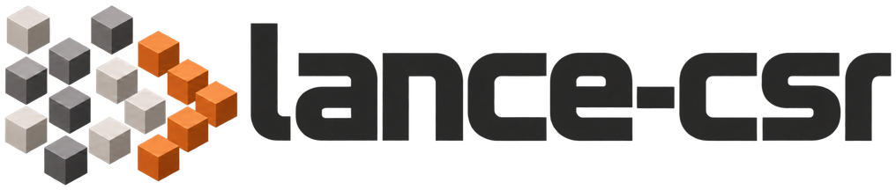

<h1>
  <picture>
    <source media="(prefers-color-scheme: dark)" srcset="docs/assets/brand/desktop-dark-1016.png">
    <source media="(prefers-color-scheme: light)" srcset="docs/assets/brand/desktop-light-1016.png">
    
  </picture>
</h1>

**Fast graph queries on Lance**

[](https://github.com/hyperdimensionalcomputingai/lance-csr/actions/workflows/rust-test.yml)
[](https://github.com/hyperdimensionalcomputingai/lance-csr/actions/workflows/python-test.yml)
[](https://pypi.org/project/lance-csr/)
[](LICENSE)

[Documentation](https://lance-csr.hdclabs.ai/) · [Examples](examples/README.md) ·
[Releases](https://github.com/hyperdimensionalcomputingai/lance-csr/releases) · [Contributing](CONTRIBUTING.md)

lance-csr is a fast graph query engine over [Lance](https://lancedb.github.io/lance/) datasets, built in Rust on
Apache DataFusion, with Python bindings. It is a fork of [lance-graph](https://github.com/lance-format/lance-graph)
and a research test bed: it pushes the limits of CSR indexes and DataFusion on top of the Lance format, with the
goal of making multi-hop path traversal fast.

**Documentation:** Visit the [lance-csr documentation site](https://lance-csr.hdclabs.ai/) for getting started,
Cypher guides, the CSR index, the Python API reference, and benchmarks.

## Goals

lance-csr is built for single-machine execution. It aims to:

- **Provide a fast, lightweight and portable query engine.** An openCypher-compatible engine on top of the Lance
  format that runs on one machine, inside your process, with no server to operate.
- **Enable multimodal knowledge graphs.** Lance stores images, video, audio and other media alongside vectors and
  structured columns. lance-csr runs fast path traversal queries over those same datasets, so a knowledge graph
  works on a single copy of the data instead of a second copy in a separate graph database.
- **Push the limits of DataFusion for graph traversal.** We want to find out how far DataFusion's execution engine
  can go in powering multi-hop graph traversal, an area with little open-source work so far.

Distributed execution is **out of scope**, and issues and pull requests that target it will be closed. If your use
case needs distributed graph queries or graph algorithms, that's the kind of engine we're building at HDC Labs:
[reach out to us](https://hyperdimensionalcomputing.ai/contact/).

## What this fork adds

- **CSR traversal** (`use_csr=True`): relationship hops and variable-length paths become array lookups instead of
  joins, updated incrementally as the Lance datasets change. See [the CSR index](https://lance-csr.hdclabs.ai/csr/).
- **A Lance-native engine** that reads each table lazily from a pinned Lance snapshot or holds it in memory, and
  `checkout_latest()`es to new versions.
- **Much wider Cypher**, enough to run the Graph Data Council's Interactive complex queries: `OPTIONAL MATCH`,
  pattern predicates, chained `WITH`, `UNWIND`, list and pattern comprehensions, `shortestPath`, `$parameters`
  and more.
- **Correctness fixes** to behaviour inherited from lance-graph, each with a regression test, and current
  dependencies (Lance 13, DataFusion 54, Arrow 58).

## Install

```bash
uv add lance-csr
```

Prebuilt wheels cover Linux x86-64, native Apple Silicon and Windows x86-64 (CPython 3.12+); no Rust toolchain is needed. On
Windows you can also use lance-csr inside WSL2, where it installs the Linux wheel. From Rust, run
`cargo add lance-csr` and see the [Rust guide](https://lance-csr.hdclabs.ai/rust/). To build from source, see [`python/DEVELOPMENT.md`](python/DEVELOPMENT.md).

## Example

```python
import pyarrow as pa
from lance_csr import CypherQuery, GraphConfig

people = pa.table({
    "person_id": [1, 2, 3, 4],
    "name": ["Alice", "Bob", "Carol", "David"],
    "age": [28, 34, 29, 42],
})

config = (
    GraphConfig.builder()
    .node_table("Person", "person_id")
    .build()
)

query = (
    CypherQuery("MATCH (p:Person) WHERE p.age > 30 RETURN p.name AS name, p.age AS age")
    .with_config(config)
)
result = query.execute({"Person": people})
print(result.to_pydict())  # {'name': ['Bob', 'David'], 'age': [34, 42]}
```

More in the [getting started guide](https://lance-csr.hdclabs.ai/getting-started/) and the
[examples](examples/README.md). For plain SQL over the same datasets, see [SQL queries](https://lance-csr.hdclabs.ai/sql/).

## Benchmarks

lance-csr is measured against other graph engines on the Graph Data Council's SNB SF1 dataset (3.18M nodes, 17.3M
relationships). The runners, queries, expected answers and results live in two repositories, whose READMEs explain
how to reproduce the runs:

- [graph-benchmark-ldbc-complex](https://github.com/hyperdimensionalcomputingai/graph-benchmark-ldbc-complex): the
  14 SNB Interactive complex read queries (IC1 to IC14).
- [graph-benchmark-ldbc](https://github.com/hyperdimensionalcomputingai/graph-benchmark-ldbc): 30 custom Cypher
  queries.

These are independent, unaudited measurements, not GDC Benchmark Results.

## Contributing

Contributions within the [project's goals](#goals) are welcome, from people and from their coding agents. Every
pull request should explain the problem it solves and back it up with evidence: a regression test for a bug fix,
and results from both benchmark suites for a code change. [`CONTRIBUTING.md`](CONTRIBUTING.md) explains what to
include and how to measure your branch against `main`. If you're unsure whether an idea fits, open an issue first.

## Credits

lance-csr builds on the work of two open-source projects:

- The maintainers and contributors of [lance-graph](https://github.com/lance-format/lance-graph), who built the
  foundation lance-csr stands on: the Cypher parser, semantic analysis, the DataFusion planner, the graph
  configuration and the Python bindings. See [`NOTICE`](NOTICE) for the fork point.
- The contributors of [Apache DataFusion](https://github.com/apache/datafusion), whose query engine does much of
  the work here: planning, optimization and vectorized execution, which lance-csr extends with its CSR traversal
  operators.
