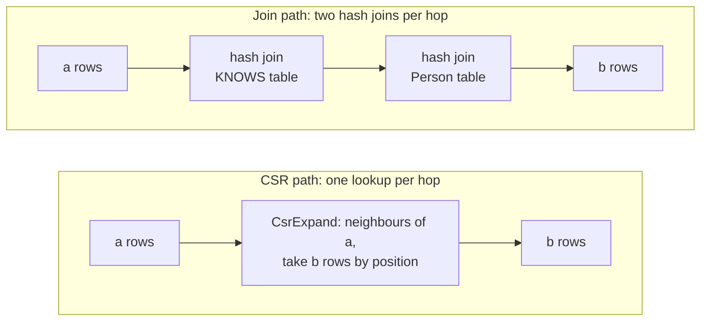

# The CSR index

The CSR is what makes lance-csr different from the project it was forked from. This page explains what it
is, how to turn it on, which queries it speeds up, and how it keeps up with changing data.

!!! abstract "In one sentence"

    `CypherEngine(config, datasets, use_csr=True)` builds a compact in-memory neighbour list for every
    relationship type, so each hop of a traversal becomes an array lookup instead of a hash join, with
    exactly the same results.

## Why joins are slow for traversal

Without a CSR, a hop such as `(a:Person)-[:KNOWS]->(b:Person)` is two hash joins: the `a` rows against the
whole `KNOWS` table, then the result against the whole `Person` table to fetch `b`. A three-hop query
repeats that three times, building a hash table and materializing every intermediate path at each step.



## What a CSR is

[Compressed sparse row](https://en.wikipedia.org/wiki/Sparse_matrix#Compressed_sparse_row_(CSR,_CRS_or_Yale_format))
is the standard compact layout for a sparse matrix, and so for a graph's adjacency. It is two arrays:

- **neighbours**: every edge's target, grouped by source;
- **offsets**: one entry per source node, pointing at where its neighbours start.

For the graph `1→2, 1→3, 2→4, 3→4`:

| Source position | 0 (node 1) | 1 (node 2) | 2 (node 3) | end |
| --- | --- | --- | --- | --- |
| `offsets` | 0 | 2 | 3 | 4 |

| Index | 0 | 1 | 2 | 3 |
| --- | --- | --- | --- | --- |
| `neighbours` | 2 | 3 | 4 | 4 |

The neighbours of the node at position `v` are `neighbours[offsets[v] .. offsets[v + 1]]`, so node 1's
are `neighbours[0..2] = [2, 3]`. One lookup, no hashing of the edge table, and each node's neighbours sit next
to each other in memory.

lance-csr builds **two** of these per relationship type, one outgoing and one incoming, so it can walk
edges in either direction.

## Turning it on

```python
import pyarrow as pa
from lance_csr import CypherEngine, GraphConfig

config = (
    GraphConfig.builder()
    .node_table("Person", "id")
    .rel_table("KNOWS", "Person", "Person", "src", "dst")
    .build()
)
datasets = {
    "Person": pa.table({"id": [1, 2, 3, 4], "name": ["Alice", "Bob", "Carol", "David"]}),
    "KNOWS": pa.table({"src": [1, 1, 2, 3], "dst": [2, 3, 4, 4]}),
}

engine = CypherEngine(config, datasets, use_csr=True)  # (1)!
```

1. The CSR is built here, in the constructor, from the relationship tables alone. Nothing changes in how you
   write queries.

`use_csr` is `False` by default. With it on, the engine builds two indexes at construction:

CSR adjacency
:   Per relationship type with integer endpoints: outgoing and incoming neighbour lists. Built from the
    relationship table only. Each neighbour also records the row its edge came from (its Lance row address,
    or its row number in an in-memory table), so a hop can fetch the relationship's own columns by position.

Node index
:   Per node label with unique integer keys: a map from key to row position. It lets the CSR fetch target
    rows by position (Lance `take_rows`, or Arrow `take` for in-memory tables) instead of joining.

!!! info "Memory cost"

    Expect about **95 bytes per edge** of extra peak memory while the CSR is built, for both directions
    together (measured at 10M edges with `python/benchmarks/csr_expand.py`). Afterwards, each direction keeps
    8 bytes per edge for the neighbour key and about 2 for the edge's row, which is stored
    [packed](internals/indexes.md#packed-edge-rows), plus about 37 bytes per source node for its offset and its
    entry in the map from key to position. On the GDC SF1 graph that's 732 MiB for 17.3 million edges, both
    directions. The index lives in memory even when the tables are read lazily from Lance.

    During query execution, each CSR expansion partition keeps one input batch and collects at most one
    output chunk of neighbour positions before fetching properties. It yields that chunk before visiting
    the remaining neighbours, even for a single high-degree node. Deleted edge positions are read from the
    shared snapshot rather than copied for each query; `checkout_latest()` resolves those positions by scanning the
    affected sources' neighbour lists.
    
    Cancellation checkpoints count source rows and frontiers with no surviving edges,
    deleted edges and suppressed reverse self-loops as work, using borrowed adjacency slices while a chunk is being collected.
    The chunk row limit comes from DataFusion's batch
    size; wide properties and multiple active partitions still increase working memory. This does not bound
    the resident graph, the input data, or buffering in joins, sorts and aggregations elsewhere in the plan.

!!! warning "Experimental"

    The CSR is marked experimental. Results are identical with it on or off (the test suite runs each
    supported shape both ways and compares), but its API and statistics may change between releases.

## Which hops use it

The CSR answers a hop when **all** of these hold:

- [x] the relationship has **integer** endpoint columns (`int8`, `int16`, `int32`, `int64`, `uint8`,
      `uint16` or `uint32`);
- [x] the hop has exactly **one relationship type** (alternation still qualifies, because each alternative is
      planned as its own branch);
- [x] the relationship has **no inline property map**: `-[:KNOWS]->` and `-[k:KNOWS]->` qualify,
      `-[:KNOWS {since: 2020}]->` does not (write `WHERE k.since = 2020` instead).

When those hold, it covers:

| Pattern | CSR? |
| --- | --- |
| `(a)-[:KNOWS]->(b)`, `(a)<-[:KNOWS]-(b)` | :material-check: outgoing or incoming adjacency |
| `(a)-[:KNOWS]-(b)` | :material-check: both adjacencies |
| `(a)-[:KNOWS*1..3]->(b)` | :material-check: one iterative expansion for the whole range |
| <code>(t:Tag)-[:hasType&#124;isSubclassOf*1..3]->(c:TagClass)</code> | :material-check: typed iterative expansion when every type and label is indexed |
| <code>(a)-[:LIKES_POST&#124;LIKES_COMMENT]->(m)</code> | :material-check: one expansion per branch |
| `OPTIONAL MATCH (a)-[:KNOWS]->(b)` | :material-check: |
| `shortestPath((a)-[:KNOWS*]-(b))` | :material-check: the search walks the CSR adjacency |
| `WHERE NOT (b)-[:KNOWS]->(a)`, `(p)-[:HAS_TAG]->()<-[:INTEREST]-(person)` | :material-check: walked per row from a bound node, through anonymous nodes and relationships of distinct types ([`PathExists`](internals/operators.md#pathexists-pattern-predicates-walked-in-place)) |
| `(a)-[k:KNOWS]->(b)` | :material-check: `k`'s other columns are fetched by edge row (single hops only) |
| `(a)-[k:KNOWS {since: 2020}]->(b)` | :material-close: hash join |
| endpoints of type `string`, `float` or `uint64` | :material-close: hash join |

Everything else in the query (filters, aggregations, sorts and any hop the CSR can't take) is planned by
DataFusion as usual. You can mix: a three-hop query might run two hops on the CSR and one as a join.

The planner chooses between the two by what the CSR can express, not by which is faster. A hop that meets the
conditions above always runs on the CSR, even when a join would be about as fast; see
[when it helps](#when-it-helps). `use_csr` is set once, for the whole engine, because it decides whether the
CSR is built at all: with `use_csr=False` every hop is a join.

Named path values and `relationships(path)` use a query-local inventory of actual edge occurrences because
CSR neighbors do not carry edge identity or properties. This also preserves parallel edges when a path
passes through `collect()` and `UNWIND`. The inventory materializes the participating node and relationship
tables; bounded traversal batches do not bound that inventory. See [path values](cypher.md#path-values).
Shortest-path queries within one node label that only read length or node keys keep the CSR route below.
Relationships crossing labels use typed identities, even for these queries, to distinguish equal keys
from different labels.

For `shortestPath` and `allShortestPaths`, a source with one target in an input batch searches from both
ends using the outgoing and incoming CSR. It expands the smaller frontier and finishes the whole layer
before joining paths, so it keeps all shortest alternatives. Several targets for the same source share
one forward search, and the forward searches of an input batch run together, up to 64 sources at a time,
so sources whose searches overlap read each neighbour list once. Undirected searches can use both ends
without a persistent CSR too; directed searches without a CSR keep their forward searches over the
adjacency built for that query.

### Variable-length traversal

An eligible variable-length path keeps one cursor per hop and yields bounded output batches. Its plan
contains one `CsrExpandExec` with `iterative hops=...`, rather than a branch for every possible length or
sequence of relationship types. It preserves duplicate matches and skips missing nodes at intermediate
hops. A node's label and key travel together, so the same integer key in two labels identifies two nodes.

The iterative path needs CSR indexes for every traversed type and direction, node indexes for every
intermediate label, and resolved labels for the endpoints. Unsupported index shapes retain the join
fallback. The 20-hop maximum still applies. `*0..` includes a zero-hop identity match when both labels and
keys agree. Undirected paths keep the existing rule that rejects immediate backtracking; neither execution
path enforces full relationship uniqueness on longer cycles.

Traversal state grows with the hop limit, not the number of pending paths. Resident graph indexes, input
batches, fetched target properties and downstream operators still contribute to query memory. Branching
graphs can produce exponentially many matches even though traversal resumes between output batches.

### Relationship variables

A hop that names its relationship, as in `MATCH (a)-[k:KNOWS]->(b) WHERE k.since > 2020 RETURN b.name`,
stays on the CSR. Each neighbour carries the row its edge came from, so the expansion fetches the columns of
`k` that the query reads by position (Lance `take` by row address, or Arrow `take`), and only those.
`explain()` shows them as `edge=k[k__since]` on the `CsrExpand` line. Parallel edges between the same two
nodes are separate rows, each with its own properties, as on the join path.

A `WHERE` condition that reads only `k`'s own columns, such as `k.since > 2020`, moves into the expansion
(`edge_filter=` in `explain()`), so failing edges are dropped before anything else is fetched. A small hop
fetches just the filter's columns for each batch of expanded edges. On a Lance dataset, once a hop has
expanded more than 1/256 of the relationship's edges, it reads the filter's columns once, in order, and skips
failing edges from then on. In-memory PyArrow tables always filter each batch, since fetching their columns
is an in-memory gather. Conditions that mix `k` with other variables stay after the expansion.

!!! note "Large hops on lazily read tables"

    A hop that expands a large share of a relationship and returns several properties of its target node
    fetches those properties one batch of scattered rows at a time. On Lance datasets read lazily, that can be
    slower than the join path, which reads the node table once. This holds whether or not the hop names its
    relationship. IC5 in the [benchmarks](benchmarks.md) is such a query.

### The fused target lookup

When the target label has a node index, the CSR expansion also replaces the join that fetches the target's
properties: each neighbour id is mapped to a row position and the row is read directly. In `explain()`
output that shows as `take=`:

```python
plan = engine.explain("MATCH (a:Person {id: 1})-[:KNOWS]->(b:Person) RETURN b.name")
print([line.strip(" |") for line in plan.splitlines() if "CsrExpandExec" in line])
# ['CsrExpandExec: key=a__id, edges=4, take=b[b__name]']
```

The fused lookup needs the target's key to be a **unique integer**. Duplicate keys, or a target that is
already bound earlier in the query, keep the CSR hop but join for the target's properties.

Only requested target columns are read. A pushed-down target filter reads its own columns first; remaining
properties are fetched only for neighbours that pass. When a column is used by both the filter and the
projection, its filtered values are reused within that output batch. Target keys come directly from the
neighbour IDs, including when a filter reads them. This reuse ends with the batch and keeps no property
cache across queries or dataset versions.

### Grouping by a node

Two-hop counts grouped by one node's id or properties can count neighbours before combining the hops.
For `MATCH (a)-[:R]->(b)-[:S]->(c) RETURN b.id, count(*)`, the engine multiplies each `b`'s counts on the
two sides. Grouping by `a.id` instead counts the second hop per `b`, follows the first hop, and sums those
counts per `a`. Both avoid expanding every two-hop path. Grouping by a property such as `b.name` also sums
the contributions of different nodes with the same value, including null.

This applies to fixed-length inner matches when the middle node has a unique integer id, every condition
reads at most one hop, and estimated fan-out justifies counting first. Same-type and undirected hops retain
the usual exclusions for reusing a relationship. A grouped outer node bound to one id keeps its selective
walk instead of counting across the graph. Groups with no valid paths are omitted. Optional matches,
distinct counts, counts of nullable properties, and grouping by several nodes keep their existing plans.

`WITH b, count(*) AS n` groups by the node `b`, and `RETURN b.id, b.name, count(*) AS n` by its id and name.
When `b`'s label has a node index, either grouping can use `b`'s id alone and looks up
`b`'s other properties afterwards, once per node, by the same row positions. Rows before a grouping can outnumber nodes many times over (an expansion), and carrying a
node's properties through the aggregate for each of them costs more than one lookup per node. With unique
ids, the groups are the same. `explain()` shows the lookup as `NodeLookupExec`, with only the properties the
query uses:

```python
plan = engine.explain(
    "MATCH (a:Person)-[:KNOWS]->(b:Person) WITH b, count(*) AS n RETURN b.name, n"
)
print([line.strip(" |") for line in plan.splitlines() if "NodeLookupExec" in line])
# ['NodeLookupExec: key=b__id, take=b[b__name]']
```

The grouping needs the id: `RETURN b.name, count(*)` groups by the name, because two people can share one.
An in-memory node table always uses the lookup. A Lance dataset read lazily uses it only when a hop fetched
`b`'s properties for the rows being grouped, as in the example above, and nothing before the grouping reads
them. That hop then reads only `b`'s id, and the lookup reads each property once per node instead of once per
edge. When `b`'s properties come from somewhere else, such as the scan that matched `b` in the first place, or
when a `WHERE` or `WITH DISTINCT` before the grouping needs them, the rows already hold them by the time they
reach the grouping, so grouping by them reads nothing more, while a lookup afterwards would read them from
disk a second time. Those groupings keep all of `b`'s properties, as before. A lookup that covers a large
share of a Lance table reads the properties in one sequential pass rather than row by row, the same switch a
[fused target lookup](#the-fused-target-lookup) makes.

### Patterns start at the most selective node

The planner rewrites each `MATCH` so traversal starts at its most selective node, walking edges backwards
where needed. That matters more with the CSR than without, because DataFusion can push a filter below a join
but not below a CSR expansion:

```python
plan = engine.explain("MATCH (a:Person)-[:KNOWS]->(b:Person {name: 'David'}) RETURN a.name")
print([line.strip(" |") for line in plan.splitlines() if "CsrExpandExec" in line])
# ['CsrExpandExec: key=b__id, edges=4, take=a[a__name]']
```

The expansion starts from `b` (`key=b__id`), the filtered node, and walks `KNOWS` incoming. Results are the
same either way; only the order of work changes.

## Inspecting the CSR

### `csr_stats()`

One entry per relationship type that has a CSR:

```python
print(engine.csr_stats()["KNOWS"])
# {'edges': 4, 'delta_edges': 0, 'tombstones': 0, 'unindexed_edges': 0,
#  'update': 'build', 'version': None, 'base_version': None,
#  'build_ms': 0.41}  (build_ms varies)
```

| Field | Meaning |
| --- | --- |
| `edges` | Live indexed edges. Edges with a null endpoint are skipped. |
| `delta_edges` | Appended edges held outside the base CSR since its last full build. |
| `tombstones` | Removed edges masked out since the last full build. |
| `unindexed_edges` | Live edges outside the base CSR: appended since its last full build and not since removed. Lance index statistics call this `num_unindexed_rows`. |
| `update` | How the last build, `checkout_latest()` or [`optimize_csr()`](#rebuilding-the-csr) produced it: `build` (first), `rebuild` (full), `loaded` (from a [stored file](#storing-the-csr), with any changes since applied as a delta), `delta` (changes applied) or `reused` (no edge change). |
| `version` | The relationship dataset's Lance version, or `None` for PyArrow input. |
| `base_version` | The version of the last full build, or `None` for PyArrow input. It trails `version` while deltas apply. |
| `build_ms` | Wall time of that build or delta, both directions. Stored files load in parallel, so their times overlap. |

A relationship type missing from `csr_stats()` has no CSR (its endpoints aren't integers) and always joins.

### `node_index_stats()`

Per node label: `rows`, `version` and `build_ms`. A label is missing when its keys are not unique integers.

```python
print(sorted(engine.node_index_stats()))  # ['Person']
```

## Keeping the CSR current

A Lance dataset gets a new version every time someone writes to it, whether that's appending rows, deleting them
or compacting its files. The engine doesn't switch versions on its own. It answers every query from the versions it
opened, so that queries stay consistent with each other, which means new writes stay invisible until you ask for
them.

`checkout_latest()` is how you ask. It moves the engine to the newest version of every Lance dataset it reads, the
way Lance's own `checkout_latest()` does for a single dataset (see Lance's
[time travel](https://lance.org/quickstart/#time-travel)), and it updates everything the engine built from those
datasets, the CSR included. Afterwards, queries see the new data and their answers are exact. When nothing has
changed, it returns almost immediately, so it's safe to call often, even on a timer. If a writer updates several
tables, call it once they've all committed, since each Lance dataset is
[pinned on its own](lance.md#lazy-version-pinned-reads).

=== "Python"

    ```python
    import lance

    lance.write_dataset(datasets["Person"], "person.lance")
    lance.write_dataset(datasets["KNOWS"], "knows.lance")
    engine = CypherEngine(
        config,
        {"Person": lance.dataset("person.lance"), "KNOWS": lance.dataset("knows.lance")},
        use_csr=True,
    )

    # David now knows Alice. The engine doesn't see the write until checkout_latest().
    lance.write_dataset(pa.table({"src": [4], "dst": [1]}), "knows.lance", mode="append")
    engine.checkout_latest()

    stats = engine.csr_stats()["KNOWS"]
    print(stats["edges"], stats["delta_edges"], stats["update"])  # 5 1 delta
    ```

=== "Rust"

    This continues the on-disk example from [Using from Rust](rust.md), where Bob gains an edge to Alice.

    ```rust
    --8<-- "crates/lance-csr/examples/embedded_query.rs:checkout_latest"
    ```

!!! caution "In-memory PyArrow tables"

    If you gave the engine in-memory PyArrow tables instead of Lance datasets, there's nothing to update: those
    tables can't change underneath the engine, so their CSR is never out of date. To query new in-memory data,
    create a new engine.

### How the CSR keeps up with new writes { #checkout-latest }

Rebuilding a CSR means reading every edge again, which takes about a second for 10 million edges. Most writes only
add or remove a few edges, so `checkout_latest()` doesn't rebuild the CSR every time. It reads just the new data,
keeps the added edges in a short list next to the CSR, called the *delta*, and marks deleted edges so that lookups
skip them. Every lookup checks the delta as well as the CSR, so the new edges show up in answers straight away.

The delta can't grow forever. Once it reaches 25% of the CSR's size, `checkout_latest()` rebuilds the CSR
from scratch instead, which empties the delta. You don't have to manage any of this. To see what a call did, look
at `update` in [`csr_stats()`](#csr_stats): `reused` (nothing changed), `delta` (new edges went into the delta) or
`rebuild` (the CSR was rebuilt), as in the example above.

??? info "Details: when `checkout_latest()` rebuilds"

    ```mermaid
    flowchart LR
        R["checkout_latest()"] -- "no edge changes" --> U["reused"]
        R -- "delta under 25% of the CSR" --> DL["delta"]
        R -- "25% or more, overwritten, or new endpoint columns" --> RB["rebuild"]
    ```

    - Compaction and `cleanup_old_versions()` don't force a rebuild: deleted rows are matched by the edge row each
      CSR entry records.
    - Writes to a node table never touch the CSR, which stores node keys rather than row positions. Only that
      label's node index is rebuilt.

### Optional: rebuilding early with `optimize_csr()` { #rebuilding-the-csr }

Most applications never need this method. `checkout_latest()` only rebuilds the CSR once the delta reaches 25%
of the CSR's size, and until then the delta stays in place. In some situations, however, it's worth rebuilding
sooner than that:

- **Large traversals.** Checking the delta on every lookup makes big traversals a little slower (in one of our experiments, we measured 5-13% slower
  with a delta of 20% of the CSR, on a graph with 10 million edges). Point lookups aren't affected.
- **Stored CSRs.** With [`persist_csr=True`](#storing-the-csr), the stored file holds the CSR without its delta, so
  every new engine re-applies the delta when it starts. A rebuild stores a fresh file, so later starts are fast
  again.

`optimize_csr()` rebuilds every CSR that has a delta, right away, instead of waiting for `checkout_latest()` to do
it. A rebuild takes about as long as building the CSR the first time, and it uses the versions the engine already
has, so new writes need a `checkout_latest()` first:

```python
engine.checkout_latest()  # new edges go into the delta
engine.optimize_csr()  # rebuilds the CSR with those edges included
stats = engine.csr_stats()["KNOWS"]
print(stats["update"], stats["unindexed_edges"])  # rebuild 0
```

It's modelled on Lance's `optimize_indices()`, which brings Lance's own indexes up to date after new writes in the
same way (see Lance's [indexing docs](https://lance.org/guide/indexing/#maintain-indexes-after-appends)).

### Which one to call

!!! tip "`checkout_latest()` or `optimize_csr()`?"

    | | `checkout_latest()` | `optimize_csr()` |
    | --- | --- | --- |
    | What it's for | Showing new writes to your queries | Rebuilding the CSR now instead of later |
    | When you need it | Every time your data changes | Rarely: for large traversals with a big delta, or with `persist_csr` |
    | Cost | Usually milliseconds; occasionally a full rebuild | About as long as the first build |

    A rebuild gives the same CSR whichever method does it. The two never run at the same time: if you call one
    while the other is running, the second waits for the first to finish, and queries keep running meanwhile.

## Storing the CSR

Every engine builds its CSR from a full scan of the relationship tables, even when the data hasn't changed since
the last run. With `persist_csr=True`, an engine over Lance datasets stores each CSR it builds and loads it on the
next start instead:

```python
def open_engine():
    lance_datasets = {"Person": lance.dataset("person.lance"), "KNOWS": lance.dataset("knows.lance")}
    return CypherEngine(config, lance_datasets, use_csr=True, persist_csr=True)

print(open_engine().csr_stats()["KNOWS"]["update"])  # build: built, then stored
print(open_engine().csr_stats()["KNOWS"]["update"])  # loaded: read from the file
```

Each relationship dataset keeps its CSR in its own directory, one file per dataset version:

```text
knows.lance/
├── _versions/  data/  _deletions/  _indices/  _transactions/
└── _lance_csr/
    └── 42.arrow
```

The file belongs to the table: dropping or copying the dataset drops or copies it, and Lance's
`cleanup_old_versions()` leaves the folder alone, since it only deletes the data, index, deletion and transaction
files it recognises.

- **Changes since the stored version** apply as a delta, read from the new fragments only, exactly as
  [`checkout_latest()`](#keeping-the-csr-current) applies them. `update` says `loaded` and `base_version` names the
  stored version. That holds after compaction and `cleanup_old_versions()` too.
- **Past the 25% threshold**, the engine rebuilds the CSR and stores the new version. Every full build is stored,
  including those from `checkout_latest()` and [`optimize_csr()`](#rebuilding-the-csr), and older files are deleted
  once a newer one is written.
- **A file that can't be used** (corrupt, written for other endpoint columns or by another format) is ignored and
  rebuilt, so a bad file costs a build, never a wrong answer.
- **A dataset that can't be written**, because of read-only storage or credentials, is built as without the option,
  and nothing is stored. Rust applications see the failed write as a `log` warning.
- **PyArrow inputs** are never stored. That includes Lance data loaded into memory with `to_table()` first.

To go back to building in memory only, create engines without `persist_csr` and delete the stored files once with
[`delete_stored_csr()`][lance_csr.CypherEngine.delete_stored_csr]. It removes the `_lance_csr` folder of every
relationship dataset the engine reads and returns how many files it deleted; the engine keeps the CSR it already
holds, so queries carry on as before:

```python
print(open_engine().delete_stored_csr())  # 1
```

!!! note "Cost"

    The file holds the CSR's arrays as they sit in memory, compressed with zstd: on SF1 about 8 bytes per edge,
    134 MiB in all. A load decompresses them and rebuilds only the map from key to position. Relationship
    types load in parallel, up to one per core and at most 10 at once, while node indexes are built from their node tables. On the GDC
    SF1 graph read lazily (17.3 million edges over 23 relationship types), measured on an Apple M5:

    | | Engine start | Peak memory |
    | --- | ---: | ---: |
    | Without `persist_csr` | 1.7 s | 1.59 to 1.66 GiB |
    | First start, building and storing 134 MiB | 2.6 s | 1.51 to 1.68 GiB |
    | Later starts, loading | 0.11 s | 1.21 to 1.30 GiB |

    Compressing adds about 0.9 s to the first start. Loading in parallel takes a quarter of the time of loading
    one type at a time, for about 0.15 GiB more peak memory; building node indexes alongside the CSR adds about
    as much to a start that builds. Query times don't
    change. `python/benchmarks/csr_persist.py` measures the same cases on a synthetic graph, including a load
    with a delta.

## When it helps

A CSR hop's cost follows the edges it reads, and it reads only the neighbours of its input rows. A hash join
reads the whole relationship table and builds a hash table on it, however few rows it starts from. So the CSR
gains most when a hop starts from few rows: a filtered node, or the result of an earlier hop.

A hop that starts from every node of a label reads every edge either way. An in-memory hash join is already
cheap there, and a CSR hop that emits one row per edge is no faster. What the CSR adds is that it can count a
node's neighbours without emitting a row per edge, and the planner uses that wherever a query only counts:

- `RETURN count(*)` over a two-hop chain `(a)-->(b)-->(c)` is the sum, over each middle node `b`, of its
  incoming times its outgoing neighbours, less the paths that would use one self-loop twice. Two hops of one
  type that share an end, `(a)-->(b)<--(c)`, or that are undirected, `(a)--(b)--(c)`, are counted from edges
  too, though not in place: the paths where `a` and `c` are the same node would use one edge twice, and finding
  them takes grouping by both ends. The second hop can be an `OPTIONAL MATCH` from `b`, where a `b` with no
  match counts once per incoming edge.
- `RETURN m.name, count(x)` over `(x)-[:R]->(m)...` (in either direction, or undirected), when nothing else
  reads `x` or the relationship, counts
  each `m`'s `x` neighbours once and plans the rest of the pattern from `m`.
- Grouping by a node's id and its other properties groups by the id alone (see
  [grouping by a node](#grouping-by-a-node)).

In `explain()` output, a hop counted in place shows `degrees=[...]` on its `CsrExpandExec` line, and its output
has one row per node rather than one per edge. A `WHERE` condition on the counted neighbour alone still applies
(`filter=` on the same line); a condition that compares it with another variable, or reads the relationship,
needs the hop's rows and keeps the plain hop.

### Spotting a hop over the whole relationship

`edges=` on a `CsrExpandExec` line is the relationship's edge count, not the number of edges the hop reads.
The hop reads all of them when its input is the whole node table: the lines below it are a scan of that table,
with no `FilterExec` and no earlier hop in between. From a 100,000-person graph with 2.4 million `FOLLOWS` edges,
`MATCH (follower:Person)-[:FOLLOWS]->(person:Person) RETURN person.name, max(follower.age)` plans:

```text
CsrExpandExec: key=follower__id, edges=2417738, take=person[person__name]
  ProjectionExec: expr=[id@0 as follower__id, age@1 as follower__age]
    KeyStatisticsExec: distinct=[id=100000]
      DataSourceExec: partitions=10, partition_sizes=[2, 2, 2, 1, 1, 1, 1, 1, 1, 1]
```

If such a hop isn't counted in place and the query is slower with `use_csr=True`, the join path is doing the
same work with less overhead. The planner won't switch that hop to a join for you: the fallback covers hops the
CSR can't take, not slower ones. Narrow the hop's input (a filter on its start node) where the query allows
it. If the workload is mostly such queries, measure it with `use_csr=False` too, as that setting applies to
every query on the engine.

## Should I turn it on?

| Situation | Recommendation |
| --- | --- |
| Queries traverse relationships, especially 2+ hops or variable-length | **Turn it on** |
| Queries read whole relationships (no filter on the start node) and only count | **Turn it on**; counts are taken per node ([when it helps](#when-it-helps)) |
| Queries read whole relationships and return or group by each edge's properties | About even with the join path; measure both |
| Integer node keys and edge endpoints | **Turn it on**. This is the fast case: each hop reads only its start nodes' neighbours, and each neighbour's properties are read straight from its row instead of through a second join ([the fused target lookup](#the-fused-target-lookup)) |
| String or UUID keys | Little benefit: the CSR can't index them, so every hop still joins whole tables. Add an integer id column if traversal matters |
| Only node lookups and aggregations, no hops | Leave it off; it costs build time and memory for nothing |
| Very large edge tables and tight memory | Budget ~95 bytes per edge of peak memory before turning it on |

The [benchmarks](benchmarks.md) were all run with `use_csr=True`, on GDC SNB data whose node keys and edge
endpoints are integers.
