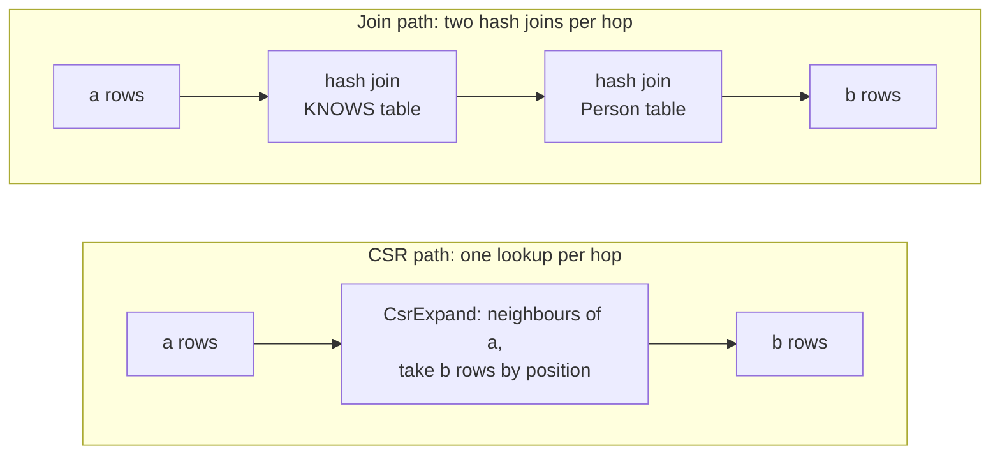

# The CSR index

The compressed sparse row (CSR) index is lance-csr's core acceleration layer. This page explains what it is, when
to turn it on, which query patterns use it, and how it stays current or persists across restarts.

!!! abstract "In one sentence"

    `CypherEngine(config, datasets, use_csr=True)` builds a compact in-memory neighbour list for every
    relationship type, turning each traversal hop from two hash joins into an array lookup, with identical query
    results.

## Why joins are slow for traversal

Without a CSR, a single hop like `(a:Person)-[:KNOWS]->(b:Person)` runs as two hash joins: `a` against the whole
`KNOWS` table, then the result against the whole `Person` table to fetch `b`. A three-hop query repeats that
pattern three times, hashing edge tables and materializing intermediate rows at every step.



## What a CSR is

[Compressed sparse row](https://en.wikipedia.org/wiki/Sparse_matrix#Compressed_sparse_row_(CSR,_CRS_or_Yale_format))
is the standard compact layout for sparse adjacency lists. It stores a graph's edges in two flat arrays:

- **neighbours**: every edge's target, grouped by source;
- **offsets**: one entry per source node, pointing to where its neighbours start.

For the edges `1→2, 1→3, 2→4, 3→4`:

| Source position | 0 (node 1) | 1 (node 2) | 2 (node 3) | end |
| --- | --- | --- | --- | --- |
| `offsets` | 0 | 2 | 3 | 4 |

| Index | 0 | 1 | 2 | 3 |
| --- | --- | --- | --- | --- |
| `neighbours` | 2 | 3 | 4 | 4 |

The neighbours of position `v` are `neighbours[offsets[v] .. offsets[v + 1]]`, so node 1's neighbours are
`neighbours[0..2] = [2, 3]`. Lookup takes one index probe with no hashing of the edge table, and each node's
neighbours sit contiguously in memory.

lance-csr builds **two** CSRs per relationship type, one outgoing and one incoming, so queries can traverse in
either direction.

## Turning it on { #turning-it-on }

```python
import pyarrow as pa
from lance_csr import CypherEngine, GraphConfig

config = (
    GraphConfig.builder()
    .node_table("Person", "id")
    .rel_table("KNOWS", "Person", "Person", "src", "dst")
    .build()
)
datasets = {
    "Person": pa.table({"id": [1, 2, 3, 4], "name": ["Alice", "Bob", "Carol", "David"]}),
    "KNOWS": pa.table({"src": [1, 1, 2, 3], "dst": [2, 3, 4, 4]}),
}

engine = CypherEngine(config, datasets, use_csr=True)  # (1)!
```

1. The CSR is built here in the constructor from the relationship tables alone. Queries stay unchanged.

`use_csr` defaults to `False`. Turning it on builds two in-memory indexes at startup:

CSR adjacency
:   Per relationship type with integer endpoints: outgoing and incoming neighbour lists, built from the
    relationship table alone. Each entry also records its edge row (Lance row address or Arrow row index) so a
    hop can fetch relationship properties by position.

Node index
:   Per node label with unique integer keys: a map from key to row position. It lets a CSR hop fetch target node
    properties directly by position (Lance `take_rows` or Arrow `take`) instead of joining.

!!! info "Memory cost"

    The CSR stays in memory even when tables are read lazily from Lance. Resident memory scales with the number
    of edges plus an index entry per source node (clustered tables with at least 1M sources where each source has
    one edge use a compact bitmap layout; see [Source layouts](internals/indexes.md#source-layouts) and
    [Packed edge rows](internals/indexes.md#packed-edge-rows)). Peak memory during the initial build is briefly
    several times the resident size. Run `python/benchmarks/csr_expand.py` on representative data to measure both
    build time and peak RSS.

    During execution, each expansion partition yields one output batch of neighbours at a time rather than
    materializing an entire high-degree node at once, though downstream joins, sorts and aggregations can still
    buffer their inputs.

!!! note "Same results either way"

    Query answers are identical with `use_csr=True` or `use_csr=False`: the test suite runs each supported shape
    both ways and compares results.

## When it helps { #when-it-helps }

A CSR hop's cost depends only on the edges reachable from its starting rows, whereas a hash join scans and hashes
the entire relationship table regardless of how few starting rows you have. The CSR therefore gives its biggest
speedups on selective starts, multi-hop traversals and variable-length paths.

| Workload | Recommendation |
| --- | --- |
| Multi-hop (2+) or variable-length traversals with integer keys | **Turn it on.** Biggest win: each hop touches only reachable neighbours and fetches target properties directly. |
| Whole-relationship scans that only count (`count(*)`, `count(x)`) | **Turn it on.** The planner counts neighbours per node in place without emitting one row per edge. |
| Whole-relationship scans returning edge or target properties | Roughly even with joins; measure both modes on your data. |
| String or UUID keys | Little benefit: the CSR cannot index non-integer keys, so hops fall back to joins. Add an integer key column if traversal speed matters. |
| Pure node lookups and aggregations (no hops) | Leave it off to avoid index build time and memory. |
| Very large edge tables under tight memory | Measure build peak memory first (`python/benchmarks/csr_expand.py`). |

All [benchmark results](benchmarks.md) run with `use_csr=True` on GDC SNB graphs with integer keys.

### Counting without expanding

When a hop starts from every node in a label, emitting one row per edge does as much work as a hash join. Where
the CSR still helps is counting: it can read each node's degree directly without materializing a row per edge:

- **Two-hop counts:** `RETURN count(*)` over `(a)-->(b)-->(c)` (including `OPTIONAL MATCH` on the second hop, or
  grouped by one node's ID/properties) multiplies or sums per-node degrees instead of expanding every two-hop
  path.
- **First-hop degree counts:** `RETURN m.name, count(x)` over `(x)-[:R]->(m)...`, when nothing else reads `x` or
  the edge, counts `x` per `m` once and plans the rest of the pattern from `m`.

In `explain()` output, an in-place count shows `degrees=[...]` on its `CsrExpandExec` line. Filters on the counted
neighbour alone still push in (`filter=`); filters referencing other variables or edge properties keep the plain
hop. See [Two-hop counts from degrees](internals/optimizer.md#two-hop-counts-from-degrees) for full planner rules.

### Spotting a hop over the whole relationship

`edges=` on a `CsrExpandExec` line reports the relationship's total edge count, not how many edges the hop read.
A hop reads the whole relationship when its child is an unfiltered table scan. For example, on a 100,000-person
graph with 2.4M `FOLLOWS` edges, `MATCH (follower:Person)-[:FOLLOWS]->(person:Person) RETURN person.name, max(follower.age)`
plans:

```text
CsrExpandExec: key=follower__id, edges=2417738, take=person[person__name]
  ProjectionExec: expr=[id@0 as follower__id, age@1 as follower__age]
    KeyStatisticsExec: distinct=[id=100000]
      DataSourceExec: partitions=10, partition_sizes=[2, 2, 2, 1, 1, 1, 1, 1, 1, 1]
```

Run `explain(query, analyze=True)` to see actual `output_rows=` and `elapsed_compute=` per operator (see
[`explain`](running-queries.md#explain)). Because the planner chooses the CSR by what it can express rather than
by estimated cost, it won't automatically switch a whole-relationship CSR hop back to a join. Narrow the starting
node with a filter where possible, or benchmark `use_csr=False` if your workload is mostly unfiltered scans of the
whole graph.

## Which hops use it { #which-hops-use-it }

A hop runs on the CSR when **all three** conditions hold:

- [x] the relationship has **integer** endpoint columns (`int8`–`int64`, `uint8`–`uint32`);
- [x] the hop has **one relationship type** (alternations still qualify because each alternative plans its own
      branch);
- [x] the relationship has **no inline property map**: `-[:KNOWS]->` and `-[k:KNOWS]->` qualify, while
      `-[:KNOWS {since: 2020}]->` uses a hash join (write `WHERE k.since = 2020` instead).

| Pattern | CSR? |
| --- | --- |
| `(a)-[:KNOWS]->(b)`, `(a)<-[:KNOWS]-(b)` | :material-check: outgoing or incoming adjacency |
| `(a)-[:KNOWS]-(b)` | :material-check: both adjacencies |
| `(a)-[:KNOWS*1..3]->(b)` | :material-check: single iterative expansion across the range |
| <code>(t:Tag)-[:hasType&#124;isSubclassOf*1..3]->(c:TagClass)</code> | :material-check: typed iterative expansion when all types and labels are indexed |
| <code>(a)-[:LIKES_POST&#124;LIKES_COMMENT]->(m)</code> | :material-check: one expansion per branch |
| `OPTIONAL MATCH (a)-[:KNOWS]->(b)`, with or without its own `WHERE` on `b` | :material-check: outer CSR expansion |
| `shortestPath((a)-[:KNOWS*]-(b))` | :material-check: BFS over the CSR adjacency |
| `WHERE NOT (b)-[:KNOWS]->(a)` | :material-check: in-place walk via [`PathExists`](internals/operators.md#pathexists-pattern-predicates-walked-in-place) |
| `(a)-[k:KNOWS]->(b)` | :material-check: edge properties fetched by row position (single hops) |
| `(a)-[k:KNOWS {since: 2020}]->(b)` | :material-close: hash join |
| `string`, `float` or `uint64` endpoints | :material-close: hash join |

Hops the CSR cannot express fall back to DataFusion hash joins in the same plan, so one query can mix CSR hops
and joins seamlessly. Everything around the hops (filters, aggregates, sorts) is still planned by DataFusion.

### Variable-length traversal { #variable-length-traversal }

Eligible variable-length paths run as one `CsrExpandExec` (`iterative hops=...`) instead of unrolling a separate
join branch per path length. The operator keeps one cursor per hop, yields bounded output batches, tracks edges by
`(relationship_type, edge_row)` so no edge is reused within a trail, and carries typed `(label, key)` pairs so
equal keys in different node tables stay distinct.

Iterative traversal requires CSR indexes for every traversed type/direction, node indexes for intermediate labels,
and resolved endpoint labels (within the 20-hop limit). Unsupported shapes fall back to join branches. Traversal
state scales with the hop limit, though branching graphs can still produce many output matches.

### Relationship variables { #relationship-variables }

A single hop that binds a relationship variable, such as
`MATCH (a)-[k:KNOWS]->(b) WHERE k.since > 2020 RETURN b.name`, stays on the CSR. Each adjacency entry stores its
edge row address, so the expansion fetches only the columns of `k` that the query uses (`edge=k[k__since]` in
`explain()`), keeping parallel edges distinct.

A `WHERE` condition reading only `k`'s properties moves into the expansion (`edge_filter=` in `explain()`) to drop
failing edges before target properties are fetched. On lazy Lance datasets, large hops automatically switch from
scattered row takes to a sequential read for fixed-width columns (up to 256 MiB); variable-width columns
(strings, lists, embeddings) and in-memory PyArrow tables always gather by position. See
[Performance details](internals/operators.md#performance-details) for exact thresholds.

!!! note "Large hops on lazily read tables"

    Expanding a large share of a relationship and returning several target properties fetches those properties one
    batch of scattered rows at a time. On lazy Lance datasets, that can be slower than a join that scans the node
    table once (as seen in IC5 in the [benchmarks](benchmarks.md)).

### The fused target lookup { #the-fused-target-lookup }

When the target label has a node index (unique integer keys), `CsrExpandExec` also replaces the join to the target
node table by reading requested target columns directly by row position (`take=` in `explain()`):

```python
plan = engine.explain("MATCH (a:Person {id: 1})-[:KNOWS]->(b:Person) RETURN b.name")
print([line.strip(" |") for line in plan.splitlines() if "CsrExpandExec" in line])
# ['CsrExpandExec: key=a__id, edges=4, take=b[b__name]']
```

Duplicate node keys, or a target already bound earlier in the query, keep the CSR hop and join for target
properties. Pushed-down target filters read only the filter's columns first, fetching remaining properties only
for passing neighbours and reusing filtered column values within the same output batch.

### Grouping by a node { #grouping-by-a-node }

When you group by a node (`WITH b, count(*) AS n`) or by its ID plus properties (`RETURN b.id, b.name, count(*)`),
carrying `b`'s properties through the aggregate for every expanded edge is wasteful. When `b` has a node index,
the planner groups by `b.id` alone and fetches `b`'s remaining properties once per group afterwards via
`NodeLookupExec`:

```python
plan = engine.explain(
    "MATCH (a:Person)-[:KNOWS]->(b:Person) WITH b, count(*) AS n RETURN b.name, n"
)
print([line.strip(" |") for line in plan.splitlines() if "NodeLookupExec" in line])
# ['NodeLookupExec: key=b__id, take=b[b__name]']
```

Grouping by `b.name` alone without `b.id` keeps a regular grouping because two people can share a name. On lazy
Lance datasets, `NodeLookupExec` is used only when it replaces a per-edge fetch (never to re-read columns from
disk a second time). Two-hop counts grouped by a single node's ID or properties can also count neighbours before
expanding; see [Grouped two-hop counts](internals/optimizer.md#grouped-two-hop-counts) and
[`NodeLookup`](internals/operators.md#nodelookup-group-by-id-then-look-up).

### Named paths and shortest paths

- **Named trail paths (`MATCH p = ...`)**: when a CSR index exists for every relationship type and direction that
  a named path traverses, the engine walks the CSR directly from the start node, evaluates inline edge maps and
  `all()`/`none()` edge filters on visited edges only, and reads relationship properties only for returned paths.
  Paths over non-CSR types (and rich shortest paths) build a query-local edge inventory instead. See
  [Path values](cypher.md#path-values) and [`PathMatch`](internals/operators.md#pathmatch-named-paths-with-real-edge-identity).
- **`shortestPath` / `allShortestPaths`**: single-target searches run bidirectionally over outgoing and incoming
  CSRs; multi-target and multi-source batches share forward searches (up to 64 sources at once). See
  [`ShortestPath`](internals/operators.md#shortestpath-breadth-first-search-over-the-adjacency).

### Patterns start at the most selective node

The planner reorders each `MATCH` to start from its most selective node, walking edges backwards where needed, so
CSR expansion starts from the smallest possible frontier:

```python
plan = engine.explain("MATCH (a:Person)-[:KNOWS]->(b:Person {name: 'David'}) RETURN a.name")
print([line.strip(" |") for line in plan.splitlines() if "CsrExpandExec" in line])
# ['CsrExpandExec: key=b__id, edges=4, take=a[a__name]']
```

Here expansion starts from `b` (`key=b__id`) and walks `KNOWS` incoming; results are identical.

## Inspecting the CSR { #inspecting-the-csr }

### `csr_stats()`

Returns one stats dict per relationship type that has a CSR:

```python
print(engine.csr_stats()["KNOWS"])
# {'edges': 4, 'delta_edges': 0, 'tombstones': 0, 'unindexed_edges': 0,
#  'update': 'build', 'version': None, 'base_version': None,
#  'build_ms': 0.41}  (build_ms varies)
```

| Field | Meaning |
| --- | --- |
| `edges` | Live indexed edges (edges with a null endpoint are skipped). |
| `delta_edges` | Appended edges held outside the base CSR since its last full build. |
| `tombstones` | Removed edges masked out since the last full build. |
| `unindexed_edges` | Live edges outside the base CSR (Lance index statistics call this `num_unindexed_rows`). |
| `update` | How the last operation produced it: `build` (initial), `rebuild` (full), `loaded` (from a [stored file](#storing-the-csr), with any later changes as a delta), `delta` (incremental update), or `reused` (no edge change). |
| `version` | Pinned Lance version of the relationship dataset, or `None` for PyArrow input. |
| `base_version` | Lance version of the last full CSR build, or `None` for PyArrow input (trails `version` while deltas apply). |
| `build_ms` | Wall time for that build or delta across both directions (stored files load in parallel, so their times overlap). |

A relationship type absent from `csr_stats()` has no CSR (non-integer endpoints) and always uses joins.

### `node_index_stats()`

Reports `rows`, `version` and `build_ms` per node label. A label is absent when its keys are not unique integers:

```python
print(sorted(engine.node_index_stats()))  # ['Person']
```

## Keeping the CSR current { #keeping-the-csr-current }

Every write to a Lance dataset creates a new version. `CypherEngine` stays pinned to the versions it opened so
queries see a consistent snapshot; new writes stay invisible until you call `checkout_latest()`.

`checkout_latest()` advances every Lance dataset to its newest version and updates all derived indexes, including
the CSR. When nothing changed, it returns almost immediately, so calling it periodically is safe. If a writer
updates multiple tables, call `checkout_latest()` after all commits finish, since each table is
[pinned independently](lance.md#lazy-version-pinned-reads).

=== "Python"

    ```python
    import lance

    lance.write_dataset(datasets["Person"], "person.lance")
    lance.write_dataset(datasets["KNOWS"], "knows.lance")
    engine = CypherEngine(
        config,
        {"Person": lance.dataset("person.lance"), "KNOWS": lance.dataset("knows.lance")},
        use_csr=True,
    )

    # David now knows Alice. The engine doesn't see the write until checkout_latest().
    lance.write_dataset(pa.table({"src": [4], "dst": [1]}), "knows.lance", mode="append")
    engine.checkout_latest()

    stats = engine.csr_stats()["KNOWS"]
    print(stats["edges"], stats["delta_edges"], stats["update"])  # 5 1 delta
    ```

=== "Rust"

    This continues the on-disk example from [Using from Rust](rust.md), where Bob gains an edge to Alice.

    ```rust
    --8<-- "crates/lance-csr/examples/embedded_query.rs:checkout_latest"
    ```

!!! caution "In-memory PyArrow tables"

    In-memory PyArrow tables cannot change underneath an engine, so their CSR never goes stale. Create a new
    engine to query updated in-memory data.

### How the CSR keeps up with new writes { #checkout-latest }

Rebuilding a CSR scans every edge again (~1 second for 10M edges). Because most commits change only a small
fraction of edges, `checkout_latest()` reads just the changed fragments, stores new edges in an in-memory *delta*
alongside the base CSR, and masks deleted edges with tombstones. Lookups check both the base CSR and the delta,
so answers are exact immediately.

Once appended delta edges plus tombstones exceed **25%** of the base CSR's size, `checkout_latest()` triggers a
full rebuild and clears the delta automatically. Check `update` in [`csr_stats()`](#csr_stats) (`reused`,
`delta`, or `rebuild`) to see what a call did.

??? info "Details: when `checkout_latest()` rebuilds"

    ```mermaid
    flowchart LR
        R["checkout_latest()"] -- "no edge changes" --> U["reused"]
        R -- "changes up to 25% of the CSR" --> DL["delta"]
        R -- "over 25%, overwritten, or new endpoint columns" --> RB["rebuild"]
    ```

    - Compaction and `cleanup_old_versions()` don't force a CSR rebuild: deletions match by each entry's edge row
      address.
    - Writes to a node table never touch the CSR (which stores raw node keys, not row positions); only that
      label's node index rebuilds.

### Optional: rebuilding early with `optimize_csr()` { #rebuilding-the-csr }

Most apps never need `optimize_csr()` because `checkout_latest()` rebuilds automatically past 25%. Calling it
early is useful in two cases:

- **Large traversals with a growing delta:** checking the delta on every lookup slowed large traversals by ~5–13%
  in experiments at a 20% delta on 10M edges (point lookups are unaffected).
- **Stored CSRs (`persist_csr=True`):** stored files hold only the base CSR, not the delta, so a rebuild writes a
  fresh file that makes future startups fast again.

`optimize_csr()` rebuilds every CSR carrying a delta using the engine's current pinned versions (call
`checkout_latest()` first to include new writes), analogous to Lance's
[`optimize_indices()`](https://lance.org/guide/indexing/#maintain-indexes-after-appends):

```python
engine.checkout_latest()  # new edges go into the delta
engine.optimize_csr()  # rebuilds the CSR with those edges included
stats = engine.csr_stats()["KNOWS"]
print(stats["update"], stats["unindexed_edges"])  # rebuild 0
```

!!! tip "`checkout_latest()` or `optimize_csr()`?"

    | | `checkout_latest()` | `optimize_csr()` |
    | --- | --- | --- |
    | Purpose | Expose new Lance writes to queries | Fold pending deltas into a fresh base CSR now |
    | When to call | Whenever data changes | Rarely: large traversals with a big delta, or to refresh `persist_csr` files |
    | Cost | Usually milliseconds; occasional full rebuild | Roughly equal to the initial build |

    The two calls are serialized against each other while queries continue running on the current snapshot.

## Storing the CSR { #storing-the-csr }

Without persistence, every new process rebuilds the CSR by scanning the relationship tables. With
`persist_csr=True`, an engine over Lance datasets saves each built CSR beside its relationship dataset and loads
it on future starts:

```python
def open_engine():
    lance_datasets = {"Person": lance.dataset("person.lance"), "KNOWS": lance.dataset("knows.lance")}
    return CypherEngine(config, lance_datasets, use_csr=True, persist_csr=True)

print(open_engine().csr_stats()["KNOWS"]["update"])  # build: built, then stored
print(open_engine().csr_stats()["KNOWS"]["update"])  # loaded: read from the file
```

Stored files live inside each relationship dataset's directory, one file per dataset version:

```text
knows.lance/
├── _versions/  data/  _deletions/  _indices/  _transactions/
└── _lance_csr/
    └── 42.arrow
```

Dropping or copying the dataset drops or copies the CSR with it, and Lance's `cleanup_old_versions()` leaves
`_lance_csr/` untouched.

- **Incremental loads:** changes written since the stored version apply as a delta (even after compaction or
  version cleanup); `update` reports `loaded` and `base_version` records the stored version.
- **Automatic refresh:** full builds past the 25% threshold (including from `checkout_latest()` and
  `optimize_csr()`) write a new file and delete older ones.
- **Safe fallback:** corrupt, incompatible or unreadable files are ignored and rebuilt in memory. On read-only
  storage, the engine checks write access before compressing, builds in memory, emits a `RuntimeWarning` (a `log`
  warning in Rust), and records `store_error` in `csr_stats()`.
- **Read-only readers (`persist_csr="load"`):** loads stored CSR files without ever writing to the dataset;
  missing or unusable files fall back to an in-memory build, and `delete_stored_csr()` raises `ValueError`.
- **PyArrow inputs** (including Lance tables materialized with `to_table()`) are never stored.

To remove stored `_lance_csr` folders from every relationship dataset (without affecting the running engine's
in-memory CSR), call [`delete_stored_csr()`][lance_csr.CypherEngine.delete_stored_csr]:

```python
print(open_engine().delete_stored_csr())  # 1
```

!!! note "Startup cost"

    Stored files hold the CSR's arrays compressed with zstd, and relationship types load concurrently (up to one
    per core, capped at 10) while node indexes build. On GDC SF1 (17M edges across 23 types), loading stored CSRs
    takes a small fraction of a full build's time and uses lower peak memory; the first start is slightly slower
    due to compression and writing. Query latency is unchanged. Benchmark your graph with
    `python/benchmarks/csr_persist.py`.
