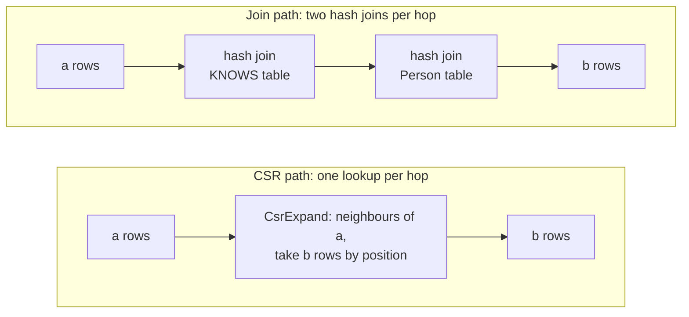
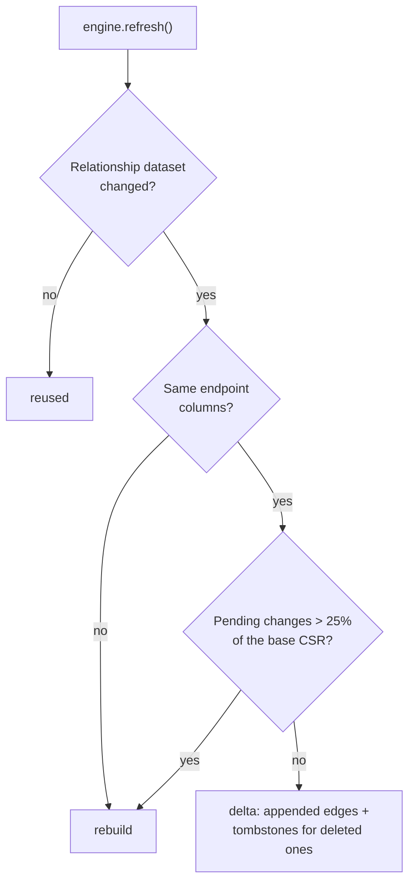

# The CSR index

The CSR is what makes lance-csr different from the project it was forked from. This page explains what it
is, how to turn it on, which queries it speeds up, and how it keeps up with changing data.

!!! abstract "In one sentence"

    `CypherEngine(config, datasets, use_csr=True)` builds a compact in-memory neighbour list for every
    relationship type, so each hop of a traversal becomes an array lookup instead of a hash join, with
    exactly the same results.

## Why joins are slow for traversal

Without a CSR, a hop such as `(a:Person)-[:KNOWS]->(b:Person)` is two hash joins: the `a` rows against the
whole `KNOWS` table, then the result against the whole `Person` table to fetch `b`. A three-hop query
repeats that three times, building a hash table and materializing every intermediate path at each step.



## What a CSR is

[Compressed sparse row](https://en.wikipedia.org/wiki/Sparse_matrix#Compressed_sparse_row_(CSR,_CRS_or_Yale_format))
is the standard compact layout for a sparse matrix, and so for a graph's adjacency. It is two arrays:

- **neighbours**: every edge's target, grouped by source;
- **offsets**: one entry per source node, pointing at where its neighbours start.

For the graph `1→2, 1→3, 2→4, 3→4`:

| Source position | 0 (node 1) | 1 (node 2) | 2 (node 3) | end |
| --- | --- | --- | --- | --- |
| `offsets` | 0 | 2 | 3 | 4 |

| Index | 0 | 1 | 2 | 3 |
| --- | --- | --- | --- | --- |
| `neighbours` | 2 | 3 | 4 | 4 |

The neighbours of the node at position `v` are `neighbours[offsets[v] .. offsets[v + 1]]`, so node 1's
are `neighbours[0..2] = [2, 3]`. One lookup, no hashing of the edge table, and each node's neighbours sit next
to each other in memory.

lance-csr builds **two** of these per relationship type, one outgoing and one incoming, so it can walk
edges in either direction.

## Turning it on

```python
import pyarrow as pa
from lance_csr import CypherEngine, GraphConfig

config = (
    GraphConfig.builder()
    .node_table("Person", "id")
    .rel_table("KNOWS", "Person", "Person", "src", "dst")
    .build()
)
datasets = {
    "Person": pa.table({"id": [1, 2, 3, 4], "name": ["Alice", "Bob", "Carol", "David"]}),
    "KNOWS": pa.table({"src": [1, 1, 2, 3], "dst": [2, 3, 4, 4]}),
}

engine = CypherEngine(config, datasets, use_csr=True)  # (1)!
```

1. The CSR is built here, in the constructor, from the relationship tables alone. Nothing changes in how you
   write queries.

`use_csr` is `False` by default. With it on, the engine builds two indexes at construction:

CSR adjacency
:   Per relationship type with integer endpoints: outgoing and incoming neighbour lists. Built from the
    relationship table only. Each neighbour also records the row its edge came from (its Lance row address,
    or its row number in an in-memory table), so a hop can fetch the relationship's own columns by position.

Node index
:   Per node label with unique integer keys: a map from key to row position. It lets the CSR fetch target
    rows by position (Lance `take_rows`, or Arrow `take` for in-memory tables) instead of joining.

!!! info "Memory cost"

    Expect about **95 bytes per edge** of extra peak memory while the CSR is built, for both directions
    together (measured at 10M edges with `python/benchmarks/csr_expand.py`). About 32 bytes per edge stay
    resident afterwards: each direction holds the neighbour key and the edge's row for every edge. The index
    lives in memory even when the tables are read lazily from Lance.

    During query execution, each CSR expansion partition keeps one input batch and collects at most one
    output chunk of neighbour positions before fetching properties. It yields that chunk before visiting
    the remaining neighbours, even for a single high-degree node. Deleted edge positions are read from the
    shared snapshot rather than copied for each query; refresh resolves those positions by scanning the
    affected sources' neighbour lists. Cancellation checkpoints count source rows and frontiers with no surviving edges,
    deleted edges and suppressed reverse self-loops as work, using borrowed adjacency slices while a chunk is being collected.
    The chunk row limit comes from DataFusion's batch
    size; wide properties and multiple active partitions still increase working memory. This does not bound
    the resident graph, the input data, or buffering in joins, sorts and aggregations elsewhere in the plan.

!!! warning "Experimental"

    The CSR is marked experimental. Results are identical with it on or off (the test suite runs each
    supported shape both ways and compares), but its API and statistics may change between releases.

## Which hops use it

The CSR answers a hop when **all** of these hold:

- [x] the relationship has **integer** endpoint columns (`int8`, `int16`, `int32`, `int64`, `uint8`,
      `uint16` or `uint32`);
- [x] the hop has exactly **one relationship type** (alternation still qualifies, because each alternative is
      planned as its own branch);
- [x] the relationship has **no inline property map**: `-[:KNOWS]->` and `-[k:KNOWS]->` qualify,
      `-[:KNOWS {since: 2020}]->` does not (write `WHERE k.since = 2020` instead).

When those hold, it covers:

| Pattern | CSR? |
| --- | --- |
| `(a)-[:KNOWS]->(b)`, `(a)<-[:KNOWS]-(b)` | :material-check: outgoing or incoming adjacency |
| `(a)-[:KNOWS]-(b)` | :material-check: both adjacencies |
| `(a)-[:KNOWS*1..3]->(b)` | :material-check: one iterative expansion for the whole range |
| <code>(t:Tag)-[:hasType&#124;isSubclassOf*1..3]->(c:TagClass)</code> | :material-check: typed iterative expansion when every type and label is indexed |
| <code>(a)-[:LIKES_POST&#124;LIKES_COMMENT]->(m)</code> | :material-check: one expansion per branch |
| `OPTIONAL MATCH (a)-[:KNOWS]->(b)` | :material-check: |
| `shortestPath((a)-[:KNOWS*]-(b))` | :material-check: the search walks the CSR adjacency |
| `(a)-[k:KNOWS]->(b)` | :material-check: `k`'s other columns are fetched by edge row (single hops only) |
| `(a)-[k:KNOWS {since: 2020}]->(b)` | :material-close: hash join |
| endpoints of type `string`, `float` or `uint64` | :material-close: hash join |

Everything else in the query (filters, aggregations, sorts and any hop the CSR can't take) is planned by
DataFusion as usual. You can mix: a three-hop query might run two hops on the CSR and one as a join.

Named path values and `relationships(path)` use a query-local inventory of actual edge occurrences because
CSR neighbors do not carry edge identity or properties. This also preserves parallel edges when a path
passes through `collect()` and `UNWIND`. The inventory materializes the participating node and relationship
tables; bounded traversal batches do not bound that inventory. See [path values](cypher.md#path-values).
Shortest-path queries within one node label that only read length or node keys keep the CSR route below.
Relationships crossing labels use typed identities, even for these queries, to distinguish equal keys
from different labels.

For `shortestPath` and `allShortestPaths`, a source with one target in an input batch searches from both
ends using the outgoing and incoming CSR. It expands the smaller frontier and finishes the whole layer
before joining paths, so it keeps all shortest alternatives. Several targets for the same source share
one forward search. Undirected searches can use both ends without a persistent CSR too; directed searches
without a CSR keep their forward search over the adjacency built for that query.

### Variable-length traversal

An eligible variable-length path keeps one cursor per hop and yields bounded output batches. Its plan
contains one `CsrExpandExec` with `iterative hops=...`, rather than a branch for every possible length or
sequence of relationship types. It preserves duplicate matches and skips missing nodes at intermediate
hops. A node's label and key travel together, so the same integer key in two labels identifies two nodes.

The iterative path needs CSR indexes for every traversed type and direction, node indexes for every
intermediate label, and resolved labels for the endpoints. Unsupported index shapes retain the join
fallback. The 20-hop maximum still applies. `*0..` includes a zero-hop identity match when both labels and
keys agree. Undirected paths keep the existing rule that rejects immediate backtracking; neither execution
path enforces full relationship uniqueness on longer cycles.

Traversal state grows with the hop limit, not the number of pending paths. Resident graph indexes, input
batches, fetched target properties and downstream operators still contribute to query memory. Branching
graphs can produce exponentially many matches even though traversal resumes between output batches.

### Relationship variables

A hop that names its relationship, as in `MATCH (a)-[k:KNOWS]->(b) WHERE k.since > 2020 RETURN b.name`,
stays on the CSR. Each neighbour carries the row its edge came from, so the expansion fetches the columns of
`k` that the query reads by position (Lance `take` by row address, or Arrow `take`), and only those.
`explain()` shows them as `edge=k[k__since]` on the `CsrExpand` line. Parallel edges between the same two
nodes are separate rows, each with its own properties, as on the join path.

A `WHERE` condition that reads only `k`'s own columns, such as `k.since > 2020`, moves into the expansion
(`edge_filter=` in `explain()`), so failing edges are dropped before anything else is fetched. A small hop
fetches just the filter's columns for each batch of expanded edges. On a Lance dataset, once a hop has
expanded more than 1/256 of the relationship's edges, it reads the filter's columns once, in order, and skips
failing edges from then on. In-memory PyArrow tables always filter each batch, since fetching their columns
is an in-memory gather. Conditions that mix `k` with other variables stay after the expansion.

!!! note "Large hops on lazily read tables"

    A hop that expands a large share of a relationship and returns several properties of its target node
    fetches those properties one batch of scattered rows at a time. On Lance datasets read lazily, that can be
    slower than the join path, which reads the node table once. This holds whether or not the hop names its
    relationship. IC5 in the [benchmarks](benchmarks.md) is such a query.

### The fused target lookup

When the target label has a node index, the CSR expansion also replaces the join that fetches the target's
properties: each neighbour id is mapped to a row position and the row is read directly. In `explain()`
output that shows as `take=`:

```python
plan = engine.explain("MATCH (a:Person {id: 1})-[:KNOWS]->(b:Person) RETURN b.name")
print([line.strip(" |") for line in plan.splitlines() if "CsrExpandExec" in line])
# ['CsrExpandExec: key=a__id, edges=4, take=b[b__name]']
```

The fused lookup needs the target's key to be a **unique integer**. Duplicate keys, or a target that is
already bound earlier in the query, keep the CSR hop but join for the target's properties.

Only requested target columns are read. A pushed-down target filter reads its own columns first; remaining
properties are fetched only for neighbours that pass. When a column is used by both the filter and the
projection, its filtered values are reused within that output batch. Target keys come directly from the
neighbour IDs, including when a filter reads them. This reuse ends with the batch and keeps no property
cache across queries or dataset versions.

### Patterns start at the most selective node

The planner rewrites each `MATCH` so traversal starts at its most selective node, walking edges backwards
where needed. That matters more with the CSR than without, because DataFusion can push a filter below a join
but not below a CSR expansion:

```python
plan = engine.explain("MATCH (a:Person)-[:KNOWS]->(b:Person {name: 'David'}) RETURN a.name")
print([line.strip(" |") for line in plan.splitlines() if "CsrExpandExec" in line])
# ['CsrExpandExec: key=b__id, edges=4, take=a[a__name]']
```

The expansion starts from `b` (`key=b__id`), the filtered node, and walks `KNOWS` incoming. Results are the
same either way; only the order of work changes.

## Inspecting the CSR

### `csr_stats()`

One entry per relationship type that has a CSR:

```python
print(engine.csr_stats()["KNOWS"])
# {'edges': 4, 'delta_edges': 0, 'tombstones': 0, 'unindexed_edges': 0,
#  'update': 'build', 'version': None, 'base_version': None,
#  'build_ms': 0.41}  (build_ms varies)
```

| Field | Meaning |
| --- | --- |
| `edges` | Live indexed edges. Edges with a null endpoint are skipped. |
| `delta_edges` | Appended edges held outside the base CSR since its last full build. |
| `tombstones` | Removed edges masked out since the last full build. |
| `unindexed_edges` | Live edges outside the base CSR: appended since its last full build and not since removed. Lance index statistics call this `num_unindexed_rows`. |
| `update` | How the last build, `refresh()` or [`optimize_csr()`](#folding-the-delta-in) produced it: `build` (first), `rebuild` (full), `delta` (changes applied) or `reused` (no edge change). |
| `version` | The relationship dataset's Lance version, or `None` for PyArrow input. |
| `base_version` | The version of the last full build, or `None` for PyArrow input. It trails `version` while deltas apply. |
| `build_ms` | Wall time of that build or delta, both directions. |

A relationship type missing from `csr_stats()` has no CSR (its endpoints aren't integers) and always joins.

### `node_index_stats()`

Per node label: `rows`, `version` and `build_ms`. A label is missing when its keys are not unique integers.

```python
print(sorted(engine.node_index_stats()))  # ['Person']
```

## Keeping the CSR current

In-memory PyArrow tables never change, so their CSR never needs updating. For Lance datasets, the engine
is pinned to a version until you call [`refresh()`](lance.md#refresh), which updates the CSR incrementally:



- **Appends** become delta edges and **deletes** become tombstones, both applied on top of the base CSR.
  Deleted and rewritten rows are matched by the row each CSR entry records, so only added fragments are
  read. Compaction and `cleanup_old_versions()` don't force a rebuild: nothing is read from the old version.
- Once the accumulated delta would exceed **25%** of the base, or the dataset was overwritten, the CSR is
  **rebuilt** and the delta folded in.
- **Node-table writes never touch the CSR**: it stores raw target keys, not row positions. A changed node
  table rebuilds only its node index.
- The replacement is validated in full before it's swapped in. If anything fails, nothing changes and the
  previous snapshot stays usable. Queries already running finish on the snapshot they started with.

The 25% threshold is fixed: lookups pay a little for every pending delta edge, and a rebuild clears them.
`python/benchmarks/csr_delta_accumulated.py` measures that trade-off. To fold the delta in sooner, call
[`optimize_csr()`](#folding-the-delta-in).

### How to keep the CSR fresh

The engine doesn't watch your datasets for changes. Keeping the CSR in step with the data is up to you:

1. **Write with any Lance writer**: `pylance`, LanceDB or another process.
2. **Call `refresh()` after the writes your queries should see.** When a writer updates several tables, call it
   after all of them commit (see [snapshots are per dataset](lance.md#lazy-version-pinned-reads)). A refresh
   with nothing new reuses the existing CSR, so calling it on a timer or before each batch of queries is fine.
3. **Check what it did with [`csr_stats()`](#csr_stats)**: `update` says whether the CSR was `reused`, updated
   with a `delta` or fully rebuilt (`rebuild`). `base_version` and `unindexed_edges` say how far the base
   CSR trails the data. Answers are exact either way: delta edges are part of every lookup.
4. **Optionally, fold the delta in with [`optimize_csr()`](#folding-the-delta-in)** at a quiet moment, so
   lookups stop carrying it.

=== "Python"

    ```python
    import lance

    lance.write_dataset(datasets["Person"], "person.lance")
    lance.write_dataset(datasets["KNOWS"], "knows.lance")
    engine = CypherEngine(
        config,
        {"Person": lance.dataset("person.lance"), "KNOWS": lance.dataset("knows.lance")},
        use_csr=True,
    )

    # David now knows Alice. The engine doesn't see the write until refresh().
    lance.write_dataset(pa.table({"src": [4], "dst": [1]}), "knows.lance", mode="append")
    engine.refresh()

    stats = engine.csr_stats()["KNOWS"]
    print(stats["edges"], stats["delta_edges"], stats["update"])  # 5 1 delta
    ```

=== "Rust"

    This continues the on-disk example from [Using from Rust](rust.md), where Bob gains an edge to Alice.

    ```rust
    --8<-- "crates/lance-csr/examples/embedded_query.rs:refresh"
    ```

A refresh can only apply a delta when it can compare the version the engine is pinned to with the latest one.
If you overwrite a relationship dataset, or remove the pinned version's files (for example with
`cleanup_old_versions()`) before refreshing, the next refresh rebuilds that CSR in full. Refresh more often
than you clean up old versions to keep updates incremental.

In-memory PyArrow tables never change. To query new in-memory data, build a new engine.

### Folding the delta in

The CSR follows Lance's own index design. A Lance index covers the fragments it was built from, and data
written after that stays unindexed: searches combine indexed results with a scan of the unindexed rows, so
answers stay correct while latency grows, until you call `optimize_indices()` (see Lance's
[index maintenance guide](https://lance.org/guide/indexing/#maintain-indexes-after-appends) and the
[index format](https://lance.org/format/index/#basic-concepts)). The CSR maps onto that one to one:

| Lance index | CSR |
| --- | --- |
| The fragments an index was built from | The base CSR, at `base_version` |
| Unindexed rows, scanned alongside the index | The delta (appended edges and tombstones), read by every lookup |
| `num_unindexed_rows` in index statistics | `unindexed_edges` in `csr_stats()` |
| `optimize_indices()` | [`optimize_csr()`][lance_csr.CypherEngine.optimize_csr] |

`optimize_csr()` rebuilds every CSR that carries a delta, at the version the engine is pinned to, so the base
covers all the data again: `unindexed_edges`, `delta_edges` and `tombstones` drop to 0, `base_version` catches
up with `version` and `update` says `rebuild`. A CSR without a delta is kept as it is, and answers never change.

```python
engine.refresh()  # applies the new edges as a delta
engine.optimize_csr()  # folds it into a new base
stats = engine.csr_stats()["KNOWS"]
print(stats["update"], stats["unindexed_edges"])  # rebuild 0
```

!!! tip "`refresh()` or `optimize_csr()`?"

    Call `refresh()` whenever your queries should see new writes. It's cheap and incremental, and it already
    rebuilds a CSR on its own once the delta passes 25% of the base. Call `optimize_csr()` only when
    `csr_stats()` shows a delta built up below that threshold and you want lookups to stop carrying it: after a
    bulk load, before a latency-sensitive run of queries, or on a schedule at a quiet time. It scans every edge
    of the relationship dataset again, like the first build, so don't call it after every refresh.

`optimize_csr()` doesn't move to newer data, so call `refresh()` first. Like `refresh()`, it builds the
replacement in full before swapping it in, and the two run one at a time.

## Should I turn it on?

| Situation | Recommendation |
| --- | --- |
| Queries traverse relationships, especially 2+ hops or variable-length | **Turn it on** |
| Integer node keys and edge endpoints | **Turn it on**; you get the fused target lookup too |
| String or UUID keys | Little benefit; add an integer id column if traversal matters |
| Only node lookups and aggregations, no hops | Leave it off; it costs build time and memory for nothing |
| Very large edge tables and tight memory | Budget ~95 bytes per edge of peak memory before turning it on |

The [benchmarks](benchmarks.md) were all run with `use_csr=True`.
