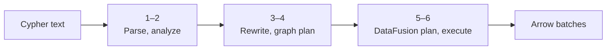
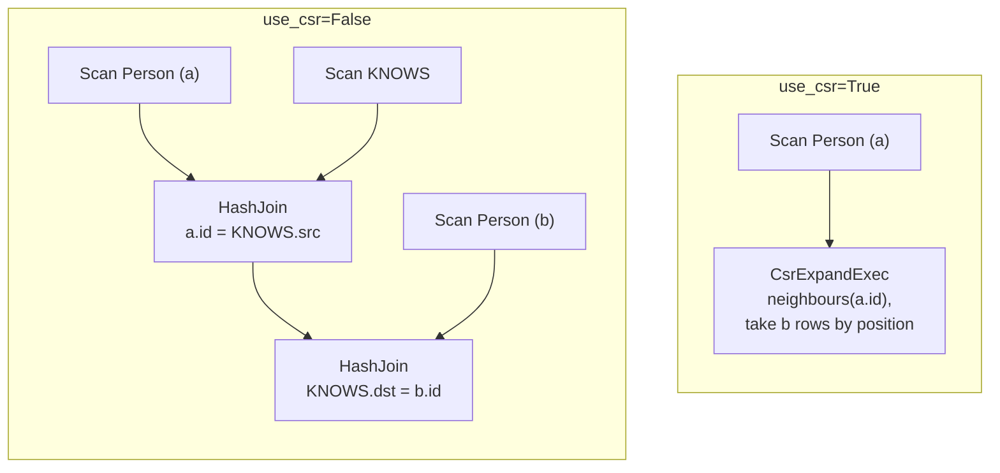
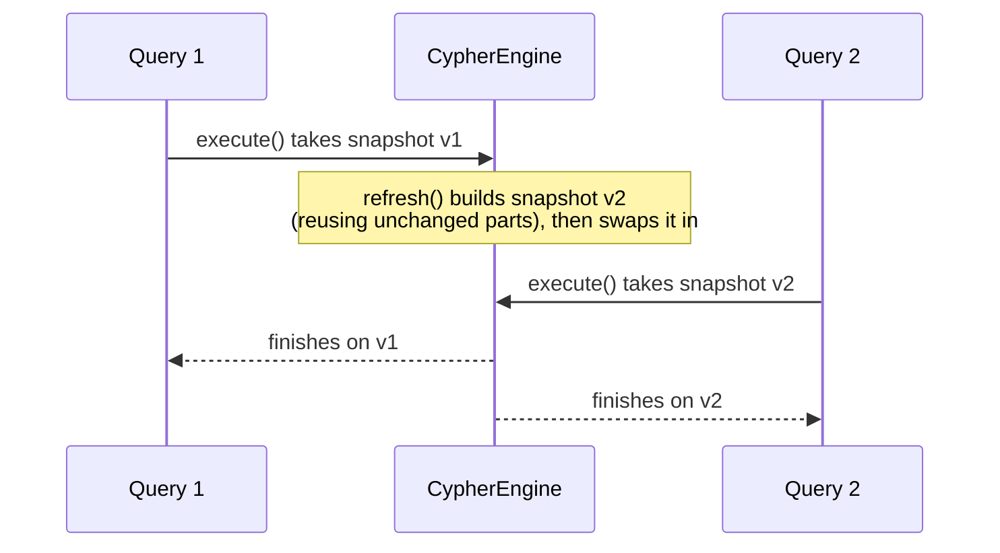

# How it works

This page follows a Cypher query from text to Arrow batches. You don't need any of it to use lance-csr, but
it explains the performance you see and what `explain()` prints.

## The pipeline

Source paths below are in `crates/lance-graph/src/`.

1. **Parse** (`parser.rs`). The query text becomes an abstract syntax tree. Syntax errors raise
   `ValueError` here.
2. **Analyze** (`semantic.rs`). Variables are resolved through `WITH` scopes, labels and functions are
   checked against the config and the supported list, and `$parameters` are substituted.
3. **Rewrite patterns** (`pattern_order.rs`, `pattern_alternatives.rs`). Each `MATCH` is reordered to start
   from its most selective node (one with a key or property filter), walking edges backwards where needed.
   Multi-label nodes and relationship alternation expand into `UNION ALL` branches. Semantics are unchanged;
   only the order of work is.
4. **Plan the graph** (`logical_plan.rs`). Graph operators describe the query: `ScanByLabel`, `Expand` for a
   hop, `VariableLengthExpand` (unrolled into one branch per length), `OptionalMatch` as a left join,
   `ShortestPath`, and `Apply` for a read-only CALL subquery.
5. **Plan for DataFusion** (`datafusion_planner/`). Each graph operator becomes DataFusion relational
   operators. A hop becomes either two hash joins or, when the engine has a [CSR](csr.md) for it, a
   `CsrExpand` extension node.
6. **Execute.** DataFusion optimizes and runs the physical plan, vectorized and multi-threaded across cores,
   with `CsrExpandExec`, the shortest-path search and `ApplyExec` as extension operators.

`engine.explain(query)` prints the plans from steps 4 to 6.

A CALL body is kept as an unoptimized child template. For each incoming row, `ApplyExec` binds its
explicit imports, plans the child, and streams that child's batches. Child `LIMIT` and aggregates
therefore apply separately to each incoming row. The operator retains one outer batch and one child
stream per partition; its children may have their own buffering requirements. Dropping the result
stream drops both owned streams. CALL queries use ordinary planning instead of the engine's template
cache.

Rust callers supplying their own `SessionContext` must install `CsrQueryPlanner` to execute CALL or
other graph extension nodes. Contexts created by `CypherQuery` and `CypherEngine` install it themselves.

## Joins versus CSR expansion

The CSR operator is a DataFusion extension, so filters, projections, aggregations and sorts around it are
still planned and optimized by DataFusion. Any hop it can't express is planned as a join in the same plan.

## Statistics for better joins

DataFusion estimates a join's output size from the distinct counts of the join keys. Lance and in-memory
tables report none, so DataFusion falls back to row counts, which badly underestimates graph joins and can
make it build a multi-million-row intermediate as one single-threaded hash table.

lance-csr computes distinct counts for every node key and edge endpoint column (from the CSR when there is
one, otherwise with one scan of the endpoint columns) and reports them to DataFusion's join planner. The
counts are cached per dataset version, so an unchanged `refresh()` costs nothing.

## Parallelism

- **In-memory tables** are split into zero-copy slices, one partition per core, so operators that don't
  repartition (such as `CsrExpandExec`) still use every core.
- **Lance datasets** are scanned by Lance's own parallel reader.
- **Python threads**: the GIL is released while a query runs, so several Python threads can query one engine
  at the same time. `Ctrl-C` interrupts a running `execute()`.

## Snapshots and concurrency

A `CypherEngine` holds an immutable **snapshot**: the open dataset handles, the DataFusion catalog, CSR
adjacencies, node indexes and key statistics. Every query takes a reference to the current snapshot when it
starts.

`refresh()` builds a complete replacement next to the current snapshot, reusing everything whose source
dataset hasn't changed, and swaps it in atomically. A failed refresh leaves the old snapshot in place.

## Single-machine scope

lance-csr runs in one process on one machine. Memory use depends on the query: lazy Lance scans and streamed
results stay bounded, while joins, sorts, aggregations and the CSR itself hold data in memory. The engine
sets no memory limit or spill-to-disk policy, and never distributes work across machines: distributed
execution is
[out of scope](index.md#what-it-is-not) for the project.
