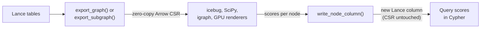

# Graph algorithms

Cypher excels at **pattern matching**—starting from specific nodes and following paths. Whole-graph algorithms
like PageRank, connected components and community detection work differently: they scan the entire graph and
produce a score or community label for every node.

Dedicated graph libraries such as [icebug](https://github.com/Ladybug-Memory/icebug), igraph and SciPy run these
algorithms efficiently over **dense CSR arrays**. lance-csr bridges your Lance tables to those libraries—and
writes the resulting node scores straight back to Lance—without copying your data into a second database:



[`CypherEngine.export_graph`][lance_csr.CypherEngine.export_graph] reads only key, endpoint and optional weight
columns from the engine's pinned dataset versions. Every parameter is optional, and all except `rel_types` are
keyword-only:

| Parameter | Default | What it controls |
| --- | --- | --- |
| `rel_types` | `None` | Relationship types to include (default: all types with integer endpoints); nodes come from their endpoint labels. |
| `directed` | `True` | `True` returns out-edge and in-edge arrays; `False` returns one undirected array set listing each edge both ways. |
| `weight` | `None` | A column name, or `{rel_type: column}` dict, exported as `float64` edge weights. |
| `combine_edges` | `"sum"` | How duplicate edges combine weights: `"sum"`, `"min"` or `"max"`. |
| `default_weight` | `None` | Fallback weight for relationship types without a weight column (`None` makes missing weight columns an error). |

To export only the subgraph selected by a Cypher query, use [`export_subgraph`](#subgraphs).

## What the export contains

Graph libraries expect nodes numbered densely from `0` to `n - 1` (*dense IDs*) with edges in two arrays:

- `indices`: every node's sorted neighbour list, concatenated;
- `indptr`: `n + 1` offsets, where node `i`'s neighbours sit at `indices[indptr[i]:indptr[i + 1]]`.

Because your primary keys are rarely `0..n-1`, the export also returns `node_keys` mapping each dense ID back to
its key:

```python
import pyarrow as pa
from lance_csr import CypherEngine, GraphConfig

config = (
    GraphConfig.builder()
    .node_table("Person", "id")
    .rel_table("FOLLOWS", "Person", "Person", "src", "dst")
    .build()
)
people = pa.table({"id": [30, 10, 20, 40], "name": ["Carol", "Alice", "Bob", "Dan"]})
follows = pa.table({"src": [10, 10, 20, 30], "dst": [20, 30, 30, 10]})
engine = CypherEngine(config, {"Person": people, "FOLLOWS": follows})

g = engine.export_graph()
print(g.node_keys.to_pylist())  # [30, 10, 20, 40]
print(g.out_indptr.to_pylist())  # [0, 1, 3, 4, 4]
print(g.out_indices.to_pylist())  # [1, 0, 2, 0]
```

Dense IDs follow the node table's order (`30 → 0`, `10 → 1`, `20 → 2`, `40 → 3`). Node `1` (key `10`) follows
nodes `0` and `2`, and isolated node `3` (key `40`) has an empty slice. CSR arrays are `uint64`; `node_keys` is
`int64`.

The returned [`GraphExport`][lance_csr.GraphExport] holds:

| Field | Meaning |
| --- | --- |
| `num_nodes`, `directed` | Total node count and whether the export is directed |
| `in_indptr`, `in_indices` | Incoming-edge arrays (`None` when `directed=False`) |
| `label_ranges` | Each label's half-open dense ID range `(start, end)` |
| `out_weights`, `in_weights` | `float64` edge weights aligned with `out_indices` / `in_indices` (`None` if unweighted) |
| `dropped_edges` | Edges skipped because an endpoint key wasn't in its node table or its weight was null |

Edges with null endpoints are skipped, dangling edges are counted in `dropped_edges`, and duplicate edges appear
once. Keys must be unique per label, and keys/endpoints must be integer columns up to `int64`.

## Directed and undirected graphs { #directed-and-undirected-graphs }

Directed algorithms such as PageRank walk incoming edges, so directed exports include `in_indptr` and
`in_indices`:

```python
print(g.in_indptr.to_pylist())  # [0, 2, 3, 4, 4]
print(g.in_indices.to_pylist())  # [1, 2, 0, 1]
```

Algorithms that ignore direction (connected components, most community detection) use `directed=False`, which
emits each edge in both directions and lists self-loops once:

```python
u = engine.export_graph(["FOLLOWS"], directed=False)
print(u.out_indptr.to_pylist())  # [0, 2, 4, 6, 6]
print(u.in_indptr)  # None
```

When an export spans multiple node labels, each label receives its own dense ID range in label-name order so equal
keys from different tables stay distinct:

```python
config2 = (
    GraphConfig.builder()
    .node_table("Person", "id")
    .node_table("City", "id")
    .rel_table("LIVES_IN", "Person", "City", "src", "dst")
    .build()
)
cities = pa.table({"id": [1, 2]})
lives_in = pa.table({"src": [10, 20], "dst": [1, 2]})
engine2 = CypherEngine(config2, {"Person": people, "City": cities, "LIVES_IN": lives_in})
print(engine2.export_graph().label_ranges)  # {'City': (0, 2), 'Person': (2, 6)}
```

## Edge weights { #edge-weights }

For weighted algorithms (weighted PageRank, Louvain/Leiden, shortest paths), name a numeric relationship column
with `weight`. The export returns `float64` arrays aligned element-for-element with `out_indices` and
`in_indices` (weights cost zero extra memory when omitted):

```python
messages = pa.table(
    {"src": [10, 10, 20, 30, 10], "dst": [20, 30, 30, 10, 20], "messages": [3, 1, 5, 2, 4]}
)
weighted_engine = CypherEngine(config, {"Person": people, "FOLLOWS": messages})
w = weighted_engine.export_graph(weight="messages")
print(w.out_indices.to_pylist())  # [1, 0, 2, 0]
print(w.out_weights.to_pylist())  # [2.0, 1.0, 7.0, 5.0]
```

Weights belong to edges only; keep node attributes in your node table and align them via `node_keys` if an
algorithm needs them.

### Combining duplicate edges and missing weights

- **Duplicate edges (`combine_edges`):** because each edge appears once in the CSR, parallel edges (and opposite
  directions under `directed=False`) combine via `"sum"` (default—ideal for counts/interaction strength: `10 → 20`
  above sums `3 + 4 = 7.0`), `"min"` (cheapest cost/distance), or `"max"` (strongest link). Self-loops count once.

```python
cheapest = weighted_engine.export_graph(weight="messages", combine_edges="min")
print(cheapest.out_weights.to_pylist())  # [2.0, 1.0, 3.0, 5.0]
```

- **Null weights:** an edge with a null weight is dropped and counted in `dropped_edges` rather than silently
  assigned a placeholder value:

```python
gaps = pa.table({"src": [10, 20], "dst": [20, 30], "messages": [3, None]})
partial = CypherEngine(config, {"Person": people, "FOLLOWS": gaps}).export_graph(weight="messages")
print(partial.out_weights.to_pylist(), partial.dropped_edges)  # [3.0] 1
```

### Several relationship types { #several-relationship-types }

When exporting multiple relationship types, pass a dict mapping each type to its weight column, and optionally
`default_weight` for types without a weight column:

```python
config3 = (
    GraphConfig.builder()
    .node_table("Person", "id")
    .rel_table("FOLLOWS", "Person", "Person", "src", "dst")
    .rel_table("MENTIONS", "Person", "Person", "src", "dst")
    .build()
)
mentions = pa.table({"src": [20], "dst": [10], "times": [9]})
mixed = CypherEngine(config3, {"Person": people, "FOLLOWS": messages, "MENTIONS": mentions})

both = mixed.export_graph(weight={"FOLLOWS": "messages", "MENTIONS": "times"})
print(both.out_weights.to_pylist())  # [2.0, 1.0, 7.0, 5.0, 9.0]
some = mixed.export_graph(weight={"FOLLOWS": "messages"}, default_weight=1.0)
print(some.out_weights.to_pylist())  # [2.0, 1.0, 7.0, 5.0, 1.0]
```

A string `weight` paired with `default_weight` uses that column on types that have it and falls back to the
default elsewhere. Without `default_weight`, a type missing a weight column raises an error. Some mistakes still
raise an error even when `default_weight` is set: naming a column in the dict that doesn't exist, including a
relationship type in the dict that isn't being exported, or passing a string column name that none of the exported
types have. Make sure combining weights across different relationship types is meaningful for your algorithm.

## Subgraphs { #subgraphs }

Running an algorithm on a filtered slice of the graph—such as active users or one region's roads—gives different
results than ranking the whole graph and filtering afterwards. [`export_subgraph`][lance_csr.CypherEngine.export_subgraph]
runs a Cypher query whose first two returned columns are `(src_key, dst_key)` and builds a `GraphExport` directly
from its matching edges:

```python
sub = engine.export_subgraph(
    "MATCH (a:Person)-[:FOLLOWS]->(b:Person) WHERE a.id = $who RETURN a.id, b.id",
    {"who": 10},
)
print(sub.node_keys.to_pylist())  # [10, 20, 30]
print(sub.out_indptr.to_pylist(), sub.out_indices.to_pylist())  # [0, 2, 2, 2] [1, 2]
print(sub.label_ranges)  # {'Person': (0, 3)}
```

Only nodes present in the result are included (Dan, key `40`, is excluded), sorted by key. When both columns come
directly from labeled node keys (`a.id`, `b.id`), `label_ranges` is populated so
[`write_node_column`](#writing-results-back-to-lance) can write scores back to the node tables (nodes outside the
subgraph receive `null`). Computed or mixed-label key columns leave `label_ranges` empty.

| Parameter | Default | What it controls |
| --- | --- | --- |
| `query`, `params` | | Cypher query returning `(src, dst [, weight])` rows and optional parameters. |
| `directed` | `True` | Directed (`True`) or undirected (`False`) arrays. |
| `weight` | `None` | Numeric output column of the query (for example `r.cost AS cost`) to export as `float64` weights. |
| `combine_edges` | `"sum"` | How repeated edges combine weights: `"sum"`, `"min"` or `"max"`. |
| `default_weight` | `None` | Without `weight`, assigns this weight to every row (letting repeated rows accumulate counts). |

Passing `default_weight=1.0` without `weight` turns repeated edge rows into multiplicity weights:

```python
counted = weighted_engine.export_subgraph(
    "MATCH (a:Person)-[:FOLLOWS]->(b:Person) RETURN a.id, b.id", default_weight=1.0
)
print(counted.out_weights.to_pylist())  # [2.0, 1.0, 1.0, 1.0]
```

As with [`execute`](running-queries.md#executequery-paramsnone), the query result is held in memory while the CSR
arrays are built.

## Running algorithms with icebug

[icebug](https://github.com/Ladybug-Memory/icebug) is a fork of [NetworKit](https://github.com/networkit/networkit)
that constructs graphs directly on Arrow CSR arrays with zero copying. Passing the arrays as keyword arguments
avoids having to remember `fromCSR`'s positional argument order:

<!-- skip-check -->
```python
import icebug as ib

graph = ib.Graph.fromCSR(  # (1)!
    n=g.num_nodes,
    directed=g.directed,
    out_indices=g.out_indices,
    out_indptr=g.out_indptr,
    in_indices=g.in_indices,
    in_indptr=g.in_indptr,
)
pagerank = ib.centrality.PageRank(
    graph, distributeSinks=ib.centrality.SinkHandling.DistributeSinks  # (2)!
)
scores = pa.table({"id": g.node_keys, "pagerank": pagerank.run().scores()})
```

1. Keep `graph` referenced for as long as any algorithm object uses it—algorithms don't retain `graph`, and a
   freed graph silently produces wrong results.
2. Redistributes sink-node rank across all nodes, matching NetworkX and standard PageRank definitions.

!!! note "Installing icebug"

    `icebug` is an optional third-party package (`uv add icebug`). Version 13.6 requires `pyarrow==26.0.1`, needs
    `networkx` installed to import, and on macOS requires Homebrew OpenMP (`brew install libomp`).

### Weighted algorithms in icebug

Pass `out_weights` and `in_weights` to `fromCSR` to run weighted PageRank, community detection or shortest paths:

<!-- skip-check -->
```python
w = weighted_engine.export_graph(weight="messages")
graph = ib.Graph.fromCSR(
    n=w.num_nodes,
    directed=w.directed,
    out_indices=w.out_indices,
    out_indptr=w.out_indptr,
    in_indices=w.in_indices,
    in_indptr=w.in_indptr,
    out_weights=w.out_weights,
    in_weights=w.in_weights,
)
pagerank = ib.centrality.PageRank(
    graph, distributeSinks=ib.centrality.SinkHandling.DistributeSinks
)
scores = pagerank.run().scores()
print([round(s, 3) for s in scores])  # [0.331, 0.329, 0.292, 0.048]
```

With message counts as weights, Bob (key `20`, dense ID `2`) rises from `0.205` to `0.292` because Alice sends him
7 messages versus 1 to Carol.

Keep two `icebug` caveats in mind: **distance/centrality algorithms treat weights as lengths** (smaller = closer,
and non-negative), whereas **PageRank and community algorithms treat weights as strengths** (larger = stronger)—so
invert strength weights with `pyarrow.compute.divide(1.0, w.out_weights)` before passing them to Dijkstra. In
addition, several `icebug` algorithms silently ignore weights.

??? note "Which `icebug 13.6` algorithms use edge weights (and editable-copy workarounds)"

    Verified by running each algorithm in `icebug 13.6` on the same graph with and without weights:

    | Module | Uses edge weights | Silently ignores edge weights |
    | --- | --- | --- |
    | `distance` | `Dijkstra`, `BidirectionalDijkstra`, `AStar`, `APSP`, `Diameter` | `BFS`, `Eccentricity` |
    | `centrality` | `PageRank`, `Betweenness`, `ApproxBetweenness`, `EstimateBetweenness`, `Closeness`, `ApproxCloseness`, `HarmonicCloseness`, `TopHarmonicCloseness`, `EigenvectorCentrality`, `KatzCentrality`, `ForestCentrality`, `SpanningEdgeCentrality` *(copy)* | `KadabraBetweenness`, `TopCloseness`, `DegreeCentrality`, `CoreDecomposition`, `LocalClusteringCoefficient` |
    | `community` | `PLM` (Louvain), `ParallelLeiden`, `PLP` | `LPDegreeOrdered` |
    | `graph` | `RandomMaximumSpanningForest` | `SpanningForest` |
    | `matching` | `PathGrowingMatcher`, `SuitorMatcher` | |
    | `flow` | `EdmondsKarp` *(copy)* | |

    - Watch out for `KadabraBetweenness` (computes unweighted betweenness without warning) and
      `centrality.ApproxElectricalCloseness` (raises an error on weighted graphs).
    - `SpanningEdgeCentrality` and `EdmondsKarp` require `indexEdges()`, which isn't supported on immutable
      `fromCSR` graphs in `icebug 13.6`. Make a weighted editable copy (doubles graph memory):

        <!-- skip-check -->
        ```python
        editable = ib.Graph(graph, weighted=True, directed=graph.isDirected())
        editable.indexEdges()
        alice, carol = 1, 0  # dense IDs of keys 10 and 30
        print(ib.flow.EdmondsKarp(editable, alice, carol).run().getMaxFlow())  # 6.0
        ```

### Other libraries and visualization

Any library that accepts CSR arrays works zero-copy via `to_numpy()`:

- **SciPy:** `scipy.sparse.csr_array((data, g.out_indices.to_numpy(), g.out_indptr.to_numpy()))`
- **GPU graph renderers (cosmos.gl, WebGL):** see [Drawing the whole graph](typescript.md#drawing-the-whole-graph)
  for exporting dense CSR links from Node.js to a browser canvas.

## Writing results back to Lance { #writing-results-back-to-lance }

[`write_node_column`][lance_csr.CypherEngine.write_node_column] joins a dense score array back onto your Lance
node tables in one call—using `label_ranges` and `node_keys` from the export—and immediately advances the engine's
node table snapshots so Cypher queries can filter and sort on the new column right away. Because relationship
tables don't change, **the CSR index is not rebuilt**:

```python
import lance

lance.write_dataset(people, "people.lance")
lance.write_dataset(follows, "follows.lance")
engine = CypherEngine(
    config, {"Person": lance.dataset("people.lance"), "FOLLOWS": lance.dataset("follows.lance")}
)
g = engine.export_graph()
indptr = g.out_indptr.to_numpy()
engine.write_node_column(g, "out_degree", indptr[1:] - indptr[:-1])  # (1)!

top = engine.execute(
    "MATCH (p:Person) RETURN p.name, p.out_degree ORDER BY p.out_degree DESC, p.name LIMIT 2"
)
print(top.to_pylist())
# [{'p.name': 'Alice', 'p.out_degree': 2}, {'p.name': 'Bob', 'p.out_degree': 1}]
```

1. `values` accepts a PyArrow array, NumPy array or Python list (such as `pagerank.run().scores()`).

Under the hood, Lance's `merge` writes only the new column's data files as a new dataset version (nodes with null
keys or outside a subgraph get `null`). Keep these practical points in mind:

- **Re-running an algorithm:** writing to an existing column raises `ValueError` unless you pass `overwrite=True`.
- **Version buildup:** each write adds a dataset version (two with `overwrite=True`); run
  [`optimize_datasets`](lance.md#compaction-and-old-versions) periodically to compact and clean up old versions.
- **Multi-label writes:** each label commits separately, so a failure partway through leaves earlier labels written.
- **In-memory or separate results:** `write_node_column` requires Lance datasets. For PyArrow inputs—or to keep
  experimental runs separate from your node table—pair `g.node_keys` with your scores directly in a `pa.table`
  and write it to a separate dataset with `lance.write_dataset`.

## Limits

- **Memory:** an export holds the whole graph in memory—8 bytes per edge in each direction for `indices`, plus
  offsets and keys (~160 MB for 10M directed edges, plus ~160 MB temporary build overhead). Weights add 8 bytes
  per edge per direction and briefly need up to 3× unweighted build memory while sorting edges with their weights.
- **Key types:** keys and endpoints must be integer columns up to `int64` (`string` and `uint64` aren't supported).
- **Single edge property:** only one numeric edge property can be exported as a weight.
