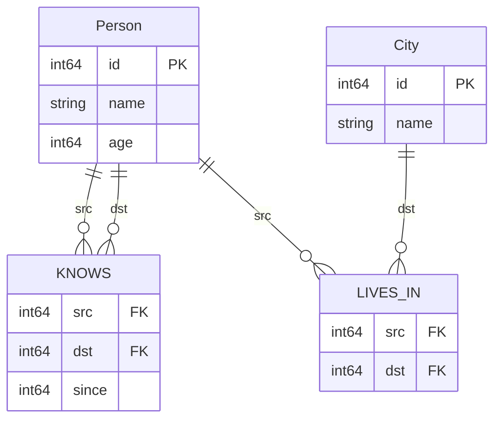

# Graph schema

lance-csr doesn't have a storage format of its own. Your graph is a set of tables, and a `GraphConfig` tells
the engine how to read them as a property graph:

- a **node table** holds one node per row, all with the same label;
- a **relationship table** holds one edge per row, all of the same type, with one column for the source
  node's key and one for the target's;
- every other column is a **property**, readable in Cypher as `n.column` or `r.column`.



## Building a `GraphConfig`

Start from `GraphConfig.builder()` (or `GraphConfigBuilder()`), add tables, and call `build()`. Each builder
method returns a new builder, so the calls chain:

```python
from lance_csr import GraphConfig

config = (
    GraphConfig.builder()
    .node_table("Person", "id")
    .node_table("City", "id")
    .rel_table("KNOWS", "Person", "Person", "src", "dst")
    .rel_table("LIVES_IN", "Person", "City", "src", "dst")
    .build()
)
print(sorted(config.node_labels()))  # ['city', 'person']
print(sorted(config.relationship_types()))  # ['knows', 'lives_in']
```

### `node_table(label, primary_key)`

| Argument | Meaning |
| --- | --- |
| `label` | The node label used in Cypher (`(p:Person)`). Also the **name of the dataset** that holds these nodes. |
| `primary_key` | The column that identifies each node. Relationship tables refer to nodes by this value. |

### `rel_table(rel_type, from_table, to_table, src, dst)`

| Argument | Meaning |
| --- | --- |
| `rel_type` | The relationship type used in Cypher (`-[:KNOWS]->`). Also the **name of the dataset** that holds these edges. |
| `from_table` | The node label at the source end. |
| `to_table` | The node label at the target end. |
| `src` | The column holding the source node's `primary_key` value. |
| `dst` | The column holding the target node's `primary_key` value. |

This mirrors `CREATE REL TABLE KNOWS (FROM Person TO Person)` in Kùzu. Knowing both ends lets the engine:

- **infer labels** you leave out: in `(p:Person)-[:LIVES_IN]->(c)`, `c` is a `City`;
- **resolve alternation**: `-[:LIKES_POST|LIKES_COMMENT]->(m)` reads each branch's target from the right
  table.

`build()` raises `ValueError` if a relationship names an endpoint label that has no `node_table`.

!!! info "Names are case-insensitive"

    Labels, relationship types, dataset names and column names all compare case-insensitively, so
    `(p:person)` matches a `Person` node table, and a `"person"` dataset key satisfies the `Person` label. The
    config reports names in lower case, in no particular order.

## Supplying the data

Queries take a `datasets` dict whose keys are the labels and relationship types from the config:

```python
import pyarrow as pa

datasets = {
    "Person": pa.table({
        "id": [1, 2, 3],
        "name": ["Alice", "Bob", "Carol"],
        "age": [28, 34, 29],
    }),
    "City": pa.table({"id": [10, 20], "name": ["London", "Sydney"]}),
    "KNOWS": pa.table({"src": [1, 2], "dst": [2, 3], "since": [2020, 2023]}),
    "LIVES_IN": pa.table({"src": [1, 2, 3], "dst": [10, 10, 20]}),
}
```

Each value can be:

=== "PyArrow"

    A `pyarrow.Table`, `pyarrow.RecordBatch` or `pyarrow.RecordBatchReader`. Anything that exports the
    [Arrow C stream interface](https://arrow.apache.org/docs/format/CStreamInterface.html), such as a pandas
    or Polars DataFrame, works too. The data is held in memory and treated as immutable.

=== "Lance dataset"

    A `lance.LanceDataset` from `lance.dataset(uri)`. `CypherEngine` reads it lazily, pinned to that
    version, and pushes projections and filters into the scan. See [Lance datasets](lance.md).

=== "LanceDB table"

    Pass `table.to_lance()`, the Lance dataset behind a LanceDB table, not the `Table` object itself. See
    [Tables created with LanceDB](lance.md#tables-created-with-lancedb).

`CypherEngine` checks at construction that every configured key and endpoint column exists in its dataset
and raises `ValueError` if one is missing. Labels in the config with no dataset are fine as long as no query
touches them.

## Properties

Every column that isn't a key is a property. Relationship columns are properties of the edge:

```python
from lance_csr import CypherEngine

engine = CypherEngine(config, datasets)
recent = engine.execute("""
    MATCH (a:Person)-[k:KNOWS]->(b:Person)
    WHERE k.since >= 2021
    RETURN a.name AS a, b.name AS b, k.since AS since
""")
print(recent.to_pylist())  # [{'a': 'Bob', 'b': 'Carol', 'since': 2023}]
```

Key columns are properties too: `p.id` returns the node's key.

## Labels in patterns

| Pattern | Meaning |
| --- | --- |
| `(p:Person)` | Nodes from the `Person` table. |
| `(m:Post:Comment)` | Nodes that are a `Post` **or** a `Comment`. Each label becomes its own branch of a `UNION ALL`. |
| `(p:Person)-[:LIVES_IN]->(c)` | `c` has no label, so it takes the `to_table` of `LIVES_IN`: `City`. |
| `MATCH (n)` | No label and nothing to infer it from: an error. Give the node a label. |

!!! example "Alternation across tables"

    With `LIKES_POST` (`Person` → `Post`) and `LIKES_COMMENT` (`Person` → `Comment`) configured,
    `MATCH (p:Person)-[:LIKES_POST|LIKES_COMMENT]->(m) RETURN m.content` returns content from both tables.
    The engine plans one branch per relationship type, each joined to the right target table.

## Keys and the CSR

Any column type works as a key for joins. The [CSR index](csr.md) is stricter: it needs **integer**
relationship endpoints (`int8` to `int64`, `uint8` to `uint32`), and its fused target lookup needs **unique
integer** node keys. If your keys are strings or UUIDs, queries still work, using joins; consider adding a
dense integer id column if traversal speed matters.

## Deprecated builder methods

The 0.1 names still work but raise a `DeprecationWarning`, and will be removed in a later release:

| Deprecated | Replacement |
| --- | --- |
| `with_node_label(label, id_field)` | `node_table(label, primary_key)` |
| `with_relationship(rel_type, source_field, target_field, source_label=None, target_label=None)` | `rel_table(rel_type, from_table, to_table, src, dst)` |

`with_relationship` makes the endpoint labels optional; without them, label inference and alternation can't
pick the right tables.
