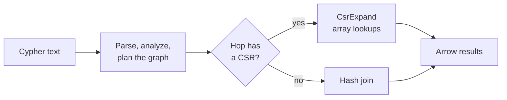

<div class="lc-hero" markdown>


</div>

# A fast graph query engine on Lance

**lance-csr** is an open source [openCypher](https://opencypher.org/) query engine for graphs stored as
[Lance](https://lance.org/) datasets or Arrow tables. Written in Rust on
[Apache DataFusion](https://datafusion.apache.org/), it ships as a Python package, a Rust crate and an npm
package, and runs embedded on one machine with no server to operate. Its distinguishing feature is a
**compressed sparse row (CSR) adjacency index** that turns each relationship hop from a hash join into an array
lookup, making multi-hop traversals fast.

=== "Python"

    ```python
    import pyarrow as pa
    from lance_csr import CypherEngine, GraphConfig

    config = (
        GraphConfig.builder()
        .node_table("Person", "id")
        .rel_table("KNOWS", "Person", "Person", "src", "dst")
        .build()
    )
    engine = CypherEngine(
        config,
        {
            "Person": pa.table({"id": [1, 2, 3], "name": ["Alice", "Bob", "Carol"]}),
            "KNOWS": pa.table({"src": [1, 2], "dst": [2, 3]}),
        },
        use_csr=True,
    )
    result = engine.execute(
        "MATCH (a:Person {name: 'Alice'})-[:KNOWS*1..2]->(b) "
        "RETURN b.name AS friend ORDER BY friend"
    )
    print(result.to_pylist())  # [{'friend': 'Bob'}, {'friend': 'Carol'}]
    ```

=== "Rust"

    ```rust
    --8<-- "crates/lance-csr/examples/embedded_query.rs:quickstart"
    ```

=== "TypeScript"

    ```typescript
    --8<-- "nodejs/examples/home.ts:quickstart"
    ```

<div class="grid cards" markdown>

-   :material-rocket-launch: **Get started**

    ---

    Install with `uv`, define a graph over a few tables, and run your first query in minutes.

    [:octicons-arrow-right-24: Getting started](getting-started.md)

-   :material-graph: **Model your graph**

    ---

    Map existing node and relationship tables onto a property graph with `GraphConfig`.

    [:octicons-arrow-right-24: Graph schema](graph-schema.md)

-   :material-lightning-bolt: **Traverse fast with the CSR**

    ---

    How `use_csr=True` accelerates multi-hop queries, stays current on writes, and persists to disk.

    [:octicons-arrow-right-24: The CSR index](csr.md)

-   :material-database: **Query Lance on disk**

    ---

    Lazy, version-pinned reads, `checkout_latest()`, streaming batches, compaction and LanceDB tables.

    [:octicons-arrow-right-24: Lance datasets](lance.md)

-   :material-vector-triangle: **Hybrid graph and vector RAG**

    ---

    Combine Cypher traversals with vector similarity filtering and reranking over the same Lance tables.

    [:octicons-arrow-right-24: Vector search](vector-search.md)

-   :material-chart-timeline-variant: **Graph algorithms and SQL**

    ---

    Export zero-copy CSR arrays to icebug or SciPy, write scores back to Lance, or mix SQL with `GRAPH_TABLE`.

    [:octicons-arrow-right-24: Graph algorithms](graph-algorithms.md) · [:octicons-arrow-right-24: SQL queries](sql.md)

</div>

## Why lance-csr?

### Fast and portable
:   An embedded openCypher engine that runs inside your Python, Rust or Node.js process on a single machine.
    Install the package and query with no database server, cluster or JVM to operate.

### One copy of your multimodal and graph data
:   Lance stores text, images, audio, video and embeddings alongside structured columns. lance-csr runs Cypher
    traversals, hybrid graph and vector queries, SQL `GRAPH_TABLE` joins and dense CSR exports directly over
    those datasets, without syncing a second copy into a standalone graph database.

### Pushing DataFusion for graph traversal plans
:   The project explores how far DataFusion's vectorized engine can go on multi-hop graph workloads. The CSR runs
    as custom DataFusion extension operators while DataFusion continues to plan and parallelize everything around
    them.

### Broad openCypher coverage
:   Supports enough read-only openCypher to run the [GDC Interactive complex queries](https://ldbcouncil.org/)
    (formerly LDBC SNB): `OPTIONAL MATCH`, `EXISTS`, chained `WITH`, `UNWIND`, list and pattern
    comprehensions, `reduce`, relationship alternation, variable-length trails, named paths, `shortestPath` and
    `$parameters`.

## Understanding the query flow



With `use_csr=True`, every hop that the CSR can express becomes a neighbour lookup; anything it can't express
falls back to an ordinary join, so enabling the CSR never changes query results. Selection depends on what the
CSR supports rather than estimated cost: see [when the CSR helps](csr.md#when-it-helps), or read
[How it works](execution.md) for the full pipeline.

## What it is not

The primary purpose of lance-csr is to serve as a fast, lightweight query engine over Lance tables on one
machine. It is not meant for distributed execution.

!!! warning "Out of scope: distributed execution"

    lance-csr is deliberately **single-machine**. Graph queries across several machines are out of scope for this
    repository, and issues or pull requests that target distributed execution are closed. If you need distributed
    graph processing, [HDC Labs](https://hyperdimensionalcomputing.ai/contact/) builds that separately.

- **Read-only query engine.** Queries never mutate your tables (`persist_csr=True` writes only CSR cache files
  beside relationship tables, and `write_node_column()` / `optimize_datasets()` are explicit maintenance calls).
  Create and update your tables with [`pylance`](https://pypi.org/project/pylance/), LanceDB or PyArrow.
- **Not a server.** There is no network protocol, authentication or multi-tenant process. It is an embedded
  library.
- **Not all of openCypher.** See the [Cypher reference](cypher.md#supported-cypher) for what is and isn't
  implemented.

## Project status

lance-csr is a fork of [lance-graph](https://github.com/lance-format/lance-graph), actively developed in open
source by [HDC Labs](https://hyperdimensionalcomputing.ai/) 😎 as a research test bed for fast multi-hop graph
queries over Lance using Cypher and Apache DataFusion.

If your use case requires distributed graph query processing or distributed graph algorithms,
[reach out to HDC Labs](https://hyperdimensionalcomputing.ai/contact/) to learn more about our distributed engine.

lance-csr is in **alpha**. Prebuilt wheels cover Linux x86-64 and aarch64, Apple Silicon and Windows x86-64 for
CPython 3.12 and newer; npm binaries cover the same platforms except Windows for Node.js 22 and newer.

[:fontawesome-brands-github: GitHub](https://github.com/hyperdimensionalcomputingai/lance-csr){ .md-button }
[:fontawesome-brands-python: PyPI](https://pypi.org/project/lance-csr/){ .md-button }
[:fontawesome-brands-rust: crates.io](https://crates.io/crates/lance-csr){ .md-button }
[:fontawesome-brands-npm: npm](https://www.npmjs.com/package/lance-csr){ .md-button }
