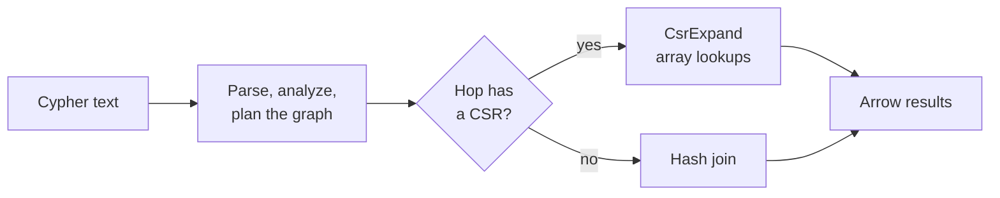

<div class="lc-hero" markdown>


</div>

# A fast graph query engine on Lance

**lance-csr** is an open source [openCypher](https://opencypher.org/) query engine for graphs stored as
[Lance](https://lancedb.github.io/lance/) datasets or Arrow tables. It is written in Rust on
[Apache DataFusion](https://datafusion.apache.org/), ships as a Python package and a Rust crate, and runs on one machine with
no server to operate. Its distinguishing feature is a **compressed sparse row (CSR) adjacency index** that turns
each relationship hop from a hash join into an array lookup, which is what makes multi-hop traversals fast.

```python
import pyarrow as pa
from lance_csr import CypherEngine, GraphConfig

config = (
    GraphConfig.builder()
    .node_table("Person", "id")
    .rel_table("KNOWS", "Person", "Person", "src", "dst")
    .build()
)
engine = CypherEngine(
    config,
    {
        "Person": pa.table({"id": [1, 2, 3], "name": ["Alice", "Bob", "Carol"]}),
        "KNOWS": pa.table({"src": [1, 2], "dst": [2, 3]}),
    },
    use_csr=True,
)
result = engine.execute(
    "MATCH (a:Person {name: 'Alice'})-[:KNOWS*1..2]->(b) "
    "RETURN b.name AS friend ORDER BY friend"
)
print(result.to_pylist())  # [{'friend': 'Bob'}, {'friend': 'Carol'}]
```

<div class="grid cards" markdown>

-   :material-rocket-launch: **Get started**

    ---

    Install with `uv`, define a graph over two tables, and run your first query in a few minutes.

    [:octicons-arrow-right-24: Getting started](getting-started.md)

-   :material-graph: **Model your graph**

    ---

    Map node labels and relationship types onto tables with `GraphConfig`.

    [:octicons-arrow-right-24: Graph schema](graph-schema.md)

-   :material-lightning-bolt: **Traverse fast with the CSR**

    ---

    What `use_csr=True` does, which patterns it accelerates, and how it stays current as data changes.

    [:octicons-arrow-right-24: The CSR index](csr.md)

-   :material-database: **Query Lance on disk**

    ---

    Lazy, version-pinned reads, `refresh()`, streaming results and LanceDB tables.

    [:octicons-arrow-right-24: Lance datasets](lance.md)

</div>

## Why lance-csr?

### Fast and portable
:   An openCypher engine that runs inside your Python process on a single machine. Install a wheel and
    query; there is no database server, cluster or JVM.

### Supports multimodal data alongside knowledge graphs
:   Lance stores images, audio, video and embeddings next to structured columns. lance-csr runs path
    traversals over those same datasets, so your knowledge graph works on one copy of the data instead of a
    second copy in a separate graph database.

### Pushing DataFusion for graph traversal query plans
:   The project is a research test bed for how far DataFusion's vectorized engine can go on multi-hop
    graph queries. The CSR runs as DataFusion extension operators, and DataFusion still plans everything
    around them.

### openCypher coverage
:   The Graph Data Council (GDC), formerly known as the Linked Data Benchmark Council (LDBC), maintains the
    [GDC Interactive complex queries](https://ldbcouncil.org/). lance-csr supports enough Cypher to run them:
    `OPTIONAL MATCH`, `EXISTS`, chained `WITH`, `UNWIND`, list and pattern comprehensions,
    relationship alternation, variable-length paths, `shortestPath` and `$parameters`.

## Understanding the query flow



Every hop that the CSR can answer becomes a neighbour lookup; anything it can't express falls back to an
ordinary join, so enabling the CSR never changes results. [How it works](execution.md) walks through each
stage.

## What it is not

The primary purpose of lance-csr is to serve as a fast, lightweight query engine on top of Lance tables. It's not meant for distributed execution.

!!! warning "Out of scope: distributed execution"

    lance-csr is deliberately **single-machine**. Graph queries across several machines are out of scope for
    this repository, and issues or pull requests that target distributed execution are closed. If you need
    distributed graph processing, [HDC Labs](https://hyperdimensionalcomputing.ai/contact/) builds that
    separately.

- **Read-only.** The engine queries data; it doesn't write it. Create and update your tables with
  [`pylance`](https://pypi.org/project/pylance/), LanceDB or PyArrow, then query them here.
- **Not a server.** There's no network protocol, authentication or multi-tenant process. It's a library.
- **Not all of openCypher.** See [supported Cypher](cypher.md#supported-cypher) for what is and isn't
  implemented.

## Project status

lance-csr is a fork of the [lance-graph](https://github.com/lance-format/lance-graph) project, and
[HDC Labs](https://hyperdimensionalcomputing.ai/) is continuing to build it out in open source. 😎 It was created
as a research test bed for fast multi-hop graph queries over the Lance format, using Cypher and Apache
DataFusion.

If your use case involves distributed graph query processing or graph algorithms, that is exactly the kind of
engine we're building at HDC Labs. [Reach out to us](https://hyperdimensionalcomputing.ai/contact/) to learn
more about that work.

lance-csr is in **alpha**. The CSR (`use_csr=True`) is marked experimental: results are identical with and
without it, but the API around it may change. Prebuilt wheels cover Linux x86-64 and Apple Silicon for CPython
3.12 and newer.

[:fontawesome-brands-github: GitHub](https://github.com/hyperdimensionalcomputingai/lance-csr){ .md-button }
[:fontawesome-brands-python: PyPI](https://pypi.org/project/lance-csr/){ .md-button }
[:fontawesome-brands-rust: crates.io](https://crates.io/crates/lance-csr){ .md-button }
