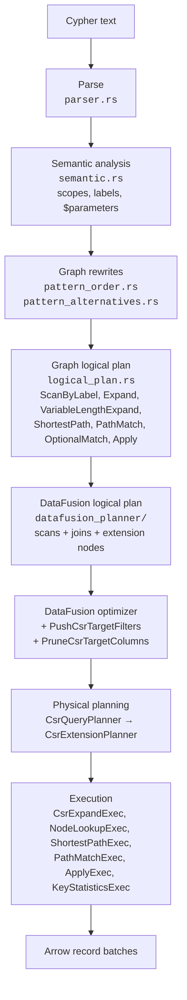

# DataFusion internals

This section is for contributors and for readers who want to know how lance-csr extends
[Apache DataFusion](https://datafusion.apache.org/) to run graph queries. You don't need any of it to use the engine:
[How it works](../execution.md) gives the short version.

lance-csr's goal is fast multi-hop traversal over data that already lives in [Lance](https://lancedb.github.io/lance/),
with no import into a graph database and no second copy of the data. DataFusion is a strong relational engine, but a
graph hop written relationally is two hash joins, and a five-hop query is ten of them. lance-csr keeps DataFusion for
everything it already does well (filters, projections, aggregates, sorts, joins, vectorized multi-threaded execution)
and adds graph-aware pieces where relational plans fall short. The [compressed sparse row (CSR) index](../csr.md) is
the data structure those pieces read.

| Page | What it covers |
| --- | --- |
| [Custom operators](operators.md) | `CsrExpand`, `NodeLookup`, `ShortestPath`, `PathMatch`, `Apply` and `KeyStatistics`, with their plans |
| [Optimizer rules and rewrites](optimizer.md) | The two logical optimizer rules, graph rewrites before DataFusion sees the plan, and join statistics |
| [Indexes and refresh](indexes.md) | How the CSR adjacency and node indexes are laid out, and how a refresh diffs Lance versions |
| [Execution plumbing](execution-plumbing.md) | Partitioning, the plan template cache, deadlines and Cypher functions |

## Design principles

- **The data stays in Lance.** Tables are read through Lance's own `LanceTableProvider`. The graph indexes store
  Lance row addresses and row ids, so a hop fetches exactly the rows it needs with `take`, and an index never holds a
  copy of node or relationship properties.
- **Every graph operator is a DataFusion extension node.** It sits inside an ordinary DataFusion plan, so everything
  around it is still planned, optimized and executed by DataFusion.
- **Results never depend on the fast path.** Any hop the CSR can't express is planned as a hash join in the same plan.
  The test suite runs each supported shape with the CSR on and off and compares the answers.
- **Bounded, streaming operators.** The extension operators yield bounded output batches and resume where they left
  off, even inside a single high-degree node's neighbour list, and they check for cancellation as they go.
- **Immutable snapshots.** An engine holds a snapshot of pinned dataset versions plus the indexes built for them.
  `refresh()` builds a replacement next to it, reusing whatever didn't change, and swaps it in atomically, so running
  queries never see a half-updated index.

## Where the extensions plug in

From graph rewrites onwards, each stage has lance-csr's own machinery. `engine.explain(query)` prints the graph
logical plan, the DataFusion logical plan and the physical plan, and every custom operator shows up in it by name.

## Every extension point

| DataFusion trait | lance-csr implementation | Role |
| --- | --- | --- |
| `UserDefinedLogicalNodeCore` | `CsrExpandNode`, `NodeLookupNode`, `ShortestPathNode`, `PathMatchNode`, `ApplyNode` | Graph operators as logical plan nodes |
| `ExecutionPlan` | `CsrExpandExec`, `NodeLookupExec`, `ShortestPathExec`, `PathMatchExec`, `ApplyExec`, `KeyStatisticsExec` | Their physical operators |
| `ExtensionPlanner` | `CsrExtensionPlanner` | Lowers each graph node to its `ExecutionPlan` |
| `QueryPlanner` | `CsrQueryPlanner` | Installs the extension planner on the session |
| `OptimizerRule` | `PushCsrTargetFilters`, `PruneCsrTargetColumns` | Filter pushdown into, and column pruning of, extension nodes |
| `PhysicalOptimizerRule` | `DeadlineJoins` (`query_deadline_joins`) | Cooperative deadlines in nested-loop and cross joins |
| `TableProvider` | `KeyStatisticsProvider` | Reports distinct counts of join keys so DataFusion sizes graph joins correctly |
| `ScalarUDFImpl` | `cypher_list`, `cypher_field`, Cypher math and scalar functions, vector distance and similarity functions | Cypher semantics that DataFusion's built-ins don't match |

`CypherEngine` builds one DataFusion session per snapshot (in `engine.rs`). It installs `CsrQueryPlanner` and adds
`PushCsrTargetFilters` before `PruneCsrTargetColumns`, so that pruning can drop the columns a moved filter reads.
Rust callers that bring their own `SessionContext` must install `CsrQueryPlanner` themselves; contexts created by
`CypherQuery` and `CypherEngine` already have it.

## Source map

All paths are under
[`crates/lance-csr/src/`](https://github.com/hyperdimensionalcomputingai/lance-csr/tree/main/crates/lance-csr/src).

| File | What it holds |
| --- | --- |
| `csr_expand.rs` | `Adjacency`, `NodeRows`, `EdgeRows`, `CsrExpandNode` and `CsrExpandExec`, `CsrExtensionPlanner`, `CsrQueryPlanner`, both optimizer rules, fragment diffing for refresh |
| `csr_expand/node_lookup.rs` | `NodeLookupNode` and `NodeLookupExec` |
| `csr_index.rs` | The compact CSR neighbour store |
| `csr_traversal.rs` | Resumable, typed variable-length walks |
| `shortest_path.rs` | `ShortestPathNode` and `ShortestPathExec`, bidirectional breadth-first search |
| `path_match.rs`, `path_inventory.rs`, `path_value.rs` | Named paths, the edge inventory, Arrow path values |
| `apply.rs` | `ApplyNode` and `ApplyExec` for CALL subqueries |
| `key_statistics.rs` | `KeyStatisticsProvider` and `KeyStatisticsExec` |
| `pattern_order.rs`, `pattern_alternatives.rs` | Re-rooting, alternation and multi-label branching |
| `logical_plan.rs` | Graph logical operators |
| `datafusion_planner/` | Graph plan to DataFusion plan; `builder/expand_ops.rs` chooses CSR or join for each hop |
| `engine.rs` | `CypherEngine`: snapshots, session setup, refresh, plan template cache |
| `query/deadline.rs` | `DeadlineJoins` and `with_execution_deadline` |
