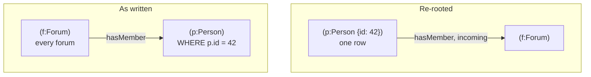

# Optimizer rules and rewrites

lance-csr changes plans at two levels: graph rewrites before the plan reaches DataFusion, and DataFusion optimizer
rules that understand the [custom operators](operators.md). It also gives DataFusion the join statistics it needs for
the hops that stay relational.

The rules, rewrites and statistics on this page were added in lance-csr. Unrolling a single-type variable-length path
into one branch per length came from [lance-graph](https://github.com/lance-format/lance-graph); lance-csr added the
iterative traversal that replaces it when the CSR covers the path.

## Logical optimizer rules

DataFusion's own optimizer treats extension nodes as opaque, so two `OptimizerRule`s fill the gaps.

### `PushCsrTargetFilters`

DataFusion can push a filter below a join, but not into an extension node. This rule splits a `Filter` above a
`CsrExpand` into its conjuncts, looking through column-only projections that projection pushdown may have left between
them, and moves:

- conjuncts that read only the fused target's columns into the node's target filter;
- conjuncts that read only the named relationship's own columns into its relationship filter.

Conjuncts that mix variables, or are volatile, stay where they were. The operator then reads just the filter's columns
for each batch of candidates, evaluates the predicate, and fetches the remaining columns only for rows that pass.
Evaluating the filter once over the whole target table was tried first; it cost more than it saved whenever the
expansion was already small, which re-rooting usually ensures.

### `PruneCsrTargetColumns`

DataFusion's projection pushdown prunes an extension node's inputs but not its outputs, so without this rule a fused
lookup would fetch every target column for every row. The rule collects the columns used anywhere in the plan and
narrows each `CsrExpand`'s target and relationship columns, and each `NodeLookup`, to that set. A `NodeLookup` whose
columns are all unused is removed. The columns a `NodeLookup` fetches shadow any of the same name below it, so the rule
prunes the plan under each lookup again, against only what that plan outputs: a hop under
`NodeLookup: take=b[b__name]` doesn't fetch `b__name` for every edge just because the lookup's `b__name` is used above.

"Used" is conservative: expression references, the plan's output columns, each CSR node's key and closing column, and
all inputs of nodes whose column use is implicit, such as `DISTINCT` and `UNION`.

### Why the order matters

`PushCsrTargetFilters` runs first. After a filter moves into the node, the columns only the filter reads are no longer
referenced above it, so `PruneCsrTargetColumns` can drop them from the output. The logical plan (before the rules) and
the physical plan (after them) of one hop show both:

```text
MATCH (a:Person {id: 1})-[k:KNOWS]->(b:Person) WHERE k.since > 2020 AND b.age > 35 RETURN b.name

logical:  CsrExpand: key=a__id -> [k__src, k__dst], edges=4, take=b[b__id*, b__name, b__age], edge=k[k__since]
physical: CsrExpandExec: key=a__id, edges=4, take=b[b__name], edge=k[], filter=age@0 > 35, edge_filter=since@0 > 2020
```

## Graph rewrites before DataFusion sees the plan

### Re-rooting: start at the most selective node

The logical planner scans a path's first node and expands left to right, so
`MATCH (f:Forum)-[:hasMember]->(p:Person) WHERE p.id = 42` would expand every forum's memberships before filtering.
The join path partly recovers because DataFusion pushes the filter below the join; a CSR expansion can't. So
`pattern_order.rs` rewrites each `MATCH` into an equivalent traversal that starts at the best-scoring node (one with a
key or property filter), walking segments backwards where needed: an outgoing edge walked from its target is incoming.



The same edges, endpoints, labels and variables are matched, and the full `WHERE` clause still applies above the
match. Only the order of work changes.

### Predicates implied by an `OR`

A condition that accepts either direction of an edge between `a` and `b` is an `OR` whose branches each read both
variables:

```cypher
WHERE (a.id = $x AND b.id = $y) OR (a.id = $y AND b.id = $x)
```

Neither re-rooting nor DataFusion's filter pushdown can use it, because no single conjunct reads only `a`. The filter
waits until both ends are bound, so the match expands from every `a`. When the pattern comprehension or `OPTIONAL
MATCH` around it is correlated with outer rows through this condition, that cost is paid for every distinct outer
binding: the official LDBC IC14 text spent minutes this way on SF1.

So when a `WHERE` is planned, `implied_by_disjunctions` in `pattern_order.rs` adds, for each variable the `OR` reads,
the `OR` of each branch without the conjuncts that read that variable. Dropping `b` above leaves
`a.id = $x OR a.id = $y`, which reads only `a` and outer values. DataFusion moves it below the expansion as an
ordinary filter or join condition, so the expansion starts from at most two people per outer row.

The added predicate is implied by the original, which stays in the filter, so the rows don't change: a true branch
makes each of its conjuncts true, so the shortened branch is true too. Nothing is added when a branch would be left
with no conjunct (`a.x = 1 OR b.y = 2` says nothing about `a` alone) or when no conjunct was dropped. Only
comparisons and `IN` lists without subqueries are copied, so no pattern or comprehension is planned twice.

### Alternation and multi-label nodes become branches

`-[:A|B]->` and `(m:Post:Comment)` are rewritten into branches with exactly one type per relationship and at most one
label per node, combined with `UNION ALL`. Only combinations consistent with the configured endpoint labels are kept,
and each branch is an ordinary pattern, so each keeps the CSR and re-rooting.

A variable-length segment with several types, such as `-[:hasType|isSubclassOf*1..20]->`, runs as one typed
[iterative traversal](../csr.md#variable-length-traversal) when every type and label is indexed. Otherwise it is
unrolled into the sequences of types whose endpoint labels chain, and each sequence is branched the same way.

Combinations that the configuration can't pin down are an error rather than a guess: joining an edge type to the
wrong node table silently matches wrong rows whenever two labels share ids.

### List comprehensions keep each row once

`[p IN posts WHERE ...]` is evaluated relationally: the rows are numbered, each row's list becomes one row per element,
the filter (and any pattern predicate, through [`PathExists`](operators.md#pathexists-pattern-predicates-walked-in-place)
or its fallback) runs on those element rows, and the kept elements are counted or collected back per row number.
Two details keep this from repeating each row's data once per element:

- The list is unnested beside its element positions, so an element row holds its own item rather than a copy of the
  whole list.
- A list read from a column, such as `posts` from an earlier `collect(post)`, is not a grouping key on the way back.
  It is rebuilt once per row from its elements, in order (null for a null list, empty for an empty one), so when the
  comprehension doesn't read the list itself, projection pushdown drops it before the unnest.

A list of nodes binds each element to its node through a [`NodeLookup`](operators.md#nodelookup-group-by-id-then-look-up)
when the node table is in memory, rather than a hash join against the whole table.

### Two-hop counts from degrees

`MATCH (a)-[:R]->(b)-[:S]->(c) RETURN count(*)` counts paths, and the paths through a middle node `b` number
`n1(b) × n2(b)`: its neighbours on each side that pass that side's filters. `count_ops.rs` plans the count as
`Σ n1(b) × n2(b)` (eager aggregation, after Yan and Larson), so the work follows the edges, not the paths. Each hop
is planned from `b` on its own, after any filter on `b` alone, and grouped to one row per `b` before the two sides
join on `b`'s id. When both hops have the same type, Cypher's rule that a path uses each edge once excludes the pairs
that reuse a self-loop at `b`, so the planner subtracts `s1(b) × s2(b)`, the self-loops counted on each side. Two
same-type hops that share an end, such as `(a)-[:R]->(b)<-[:R]-(c)`, instead exclude every pair whose far ends are
the same node `x`, and their edges are compared by endpoints, so `k` parallel edges between `b` and `x` exclude `k²`
pairs. Those hops are grouped by both ends, `b` and the far end, and then by `b`, which gives `n1(b)`, `n2(b)` and
the excluded pairs `Σ k1(b, x) × k2(b, x)` in one pass over the edges; they don't count in place. It applies when every `WHERE` condition reads one hop's variables, and the hops' mean fan-outs at `b` (from the
[join statistics](#join-statistics-for-graph-workloads)) say there are at least twice as many paths as edges.

A relationship variable no condition reads is left unbound, so the CSR doesn't fetch its edge rows. Each side's
grouping is a `HopDegreesNode` over the aggregate. After `PushCsrTargetFilters` has moved the side's far-end filter
into its `CsrExpand`, the `CountCsrDegrees` rule replaces it: a CSR hop with at most that filter counts each node's
neighbours in place ([`degrees=`](operators.md#what-one-expansion-can-do)), one row per node, and any other hop keeps
the aggregate. The rule runs in the optimizer, not while planning, because the far-end filter may hold query
parameters, and those are bound into the cached plan template after it is planned. On a graph of 100,000 people and 2.4
million `FOLLOWS` edges:

```text
MATCH (a:Person)-[r1:FOLLOWS]->(b:Person)-[r2:FOLLOWS]->(c:Person)
WHERE b.age < $age_1 AND c.age > $age_2 RETURN count(*) AS numpaths

ProjectionExec: expr=[CASE WHEN __paths@0 IS NOT NULL THEN __paths@0 ELSE 0 END as numpaths]
  AggregateExec: mode=Final, gby=[], aggr=[sum(__n1 * __n2 - __s1 * __s2) as __paths]
    CoalescePartitionsExec
      AggregateExec: mode=Partial, gby=[], aggr=[sum(__n1 * __n2 - __s1 * __s2) as __paths]
        HashJoinExec: mode=Partitioned, join_type=Inner, on=[(__m1@0, __m2@0)], projection=[__n1@1, __s1@2, __n2@4, __s2@5]
          RepartitionExec: partitioning=Hash([__m1@0], 10), input_partitions=10
            ProjectionExec: expr=[b__id@0 as __m1, __n1@1 as __n1, __s1@2 as __s1]
              CsrExpandExec: key=b__id, edges=2417738, take=a[], degrees=[__n1, __s1]
                ProjectionExec: expr=[id@0 as b__id]
                  FilterExec: age@1 < 50, projection=[id@0]
                    KeyStatisticsExec: distinct=[id=100000]
                      DataSourceExec: partitions=10, partition_sizes=[2, 2, 2, 1, 1, 1, 1, 1, 1, 1]
          RepartitionExec: partitioning=Hash([__m2@0], 10), input_partitions=10
            ProjectionExec: expr=[b__id@0 as __m2, __n2@1 as __n2, __s2@2 as __s2]
              CsrExpandExec: key=b__id, edges=2417738, take=c[], filter=age@0 > 25, degrees=[__n2, __s2]
                ProjectionExec: expr=[id@0 as b__id]
                  FilterExec: age@1 < 50, projection=[id@0]
                    KeyStatisticsExec: distinct=[id=100000]
                      DataSourceExec: partitions=10, partition_sizes=[2, 2, 2, 1, 1, 1, 1, 1, 1, 1]
```

### Counting the first hop per node

`MATCH (x)-[:R]->(m)-[:S]->(c) RETURN c.name, count(x)` doesn't need `x`'s rows, only how many there are for each
`m`. When every aggregate is a plain count of rows and nothing else reads `x` or the relationship, the planner
counts each `m`'s `x` neighbours once, through the same `HopDegreesNode`, plans the rest of the pattern from `m`,
joins the counts on `m`'s id, and sums them in place of the count. Conditions on `x` alone filter the counted
neighbours. It applies only with the CSR and when the hop's mean fan-out at `m` is at least two, so that the counts
are fewer than the edges.

Without it, the first hop's edges come out of the CSR expansion one row each, and those rows reach the aggregate spread
over every partition, so each partition's partial aggregate holds a row for nearly every group. On the benchmark
graph that made `RETURN person.name, count(follower.id), city.city, city.state, city.country` over two hops about
three times slower than the join path. Counting first, the rest of the pattern and the aggregate see one row per
person:

```text
MATCH (follower:Person)-[:FOLLOWS]->(person:Person)-[:LIVES_IN]->(city:City)
RETURN person.name AS name, count(follower.id) AS numfollowers, city.city AS city, city.state AS state,
       city.country AS country ORDER BY numfollowers DESC LIMIT 1

SortPreservingMergeExec: [numfollowers@1 DESC], fetch=1
  SortExec: TopK(fetch=1), expr=[numfollowers@1 DESC], preserve_partitioning=[true]
    ProjectionExec: expr=[person__name@0 as name, CASE WHEN __agg_0@4 IS NOT NULL THEN __agg_0@4 ELSE 0 END as numfollowers, city__city@1 as city, city__state@2 as state, city__country@3 as country]
      AggregateExec: mode=FinalPartitioned, gby=[person__name@0 as person__name, city__city@1 as city__city, city__state@2 as city__state, city__country@3 as city__country], aggr=[sum(__n0) as __agg_0]
        RepartitionExec: partitioning=Hash([person__name@0, city__city@1, city__state@2, city__country@3], 10), input_partitions=10
          AggregateExec: mode=Partial, gby=[person__name@0 as person__name, city__city@1 as city__city, city__state@2 as city__state, city__country@3 as city__country], aggr=[sum(__n0) as __agg_0]
            HashJoinExec: mode=CollectLeft, join_type=Inner, on=[(person__id@0, __m0@0)], projection=[person__name@1, city__city@2, city__state@3, city__country@4, __n0@6]
              CoalescePartitionsExec
                ProjectionExec: expr=[person__id@0 as person__id, person__name@1 as person__name, city__city@4 as city__city, city__state@5 as city__state, city__country@6 as city__country]
                  CsrExpandExec: key=person__id, edges=100000, take=city[city__city, city__state, city__country]
                    ProjectionExec: expr=[id@0 as person__id, name@1 as person__name]
                      KeyStatisticsExec: distinct=[id=100000]
                        DataSourceExec: partitions=10, partition_sizes=[2, 2, 2, 1, 1, 1, 1, 1, 1, 1]
              ProjectionExec: expr=[person__id@0 as __m0, __n0@1 as __n0]
                CsrExpandExec: key=person__id, edges=2417738, take=follower[], degrees=[__n0, __s0]
                  ProjectionExec: expr=[id@0 as person__id]
                    KeyStatisticsExec: distinct=[id=100000]
                      DataSourceExec: partitions=10, partition_sizes=[2, 2, 2, 1, 1, 1, 1, 1, 1, 1]
```

## Join statistics for graph workloads

Not every hop runs on the CSR, and the joins that remain need good cardinality estimates. DataFusion estimates an
equi-join's output as `L × R / max(NDV_l, NDV_r)`, using the number of distinct values (NDV) of each join key.
Neither `MemTable` nor `LanceTableProvider` reports distinct counts, so DataFusion substitutes the row count. For a
graph join chain, that turns a multi-million-row intermediate into an estimate of a few thousand rows, under the
128k-row `CollectLeft` threshold, and DataFusion then builds that intermediate as one single-threaded hash table.

`KeyStatisticsProvider` wraps each table and reports distinct counts for its node-id and edge-endpoint columns, taken
from the CSR when there is one and otherwise from one scan of the endpoint columns. Every other statistic comes from
the inner table. The counts are cached per dataset version, so a `checkout_latest()` with no changes costs nothing.
