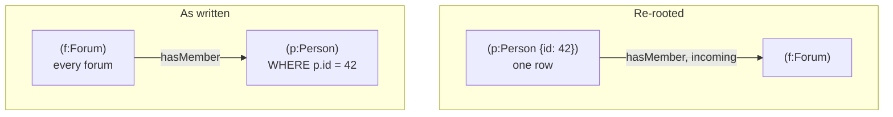

# Optimizer rules and rewrites

lance-csr changes plans at two levels: graph rewrites before the plan reaches DataFusion, and DataFusion optimizer
rules that understand the [custom operators](operators.md). It also gives DataFusion the join statistics it needs for
the hops that stay relational.

The rules, rewrites and statistics on this page were added in lance-csr. Unrolling a single-type variable-length path
into one branch per length came from [lance-graph](https://github.com/lance-format/lance-graph); lance-csr added the iterative traversal that replaces it
when the CSR covers the path.

## Logical optimizer rules

DataFusion's own optimizer treats extension nodes as opaque, so two `OptimizerRule`s fill the gaps.

### `PushCsrTargetFilters`

DataFusion can push a filter below a join, but not into an extension node. This rule splits a `Filter` above a
`CsrExpand` into its conjuncts, looking through column-only projections that projection pushdown may have left between
them, and moves:

- conjuncts that read only the fused target's columns into the node's target filter;
- conjuncts that read only the named relationship's own columns into its relationship filter.

Conjuncts that mix variables, or are volatile, stay where they were. The operator then reads just the filter's columns
for each batch of candidates, evaluates the predicate, and fetches the remaining columns only for rows that pass.
Evaluating the filter once over the whole target table was tried first; it cost more than it saved whenever the
expansion was already small, which re-rooting usually ensures.

### `PruneCsrTargetColumns`

DataFusion's projection pushdown prunes an extension node's inputs but not its outputs, so without this rule a fused
lookup would fetch every target column for every row. The rule collects the columns used anywhere in the plan and
narrows each `CsrExpand`'s target and relationship columns, and each `NodeLookup`, to that set. A `NodeLookup` whose
columns are all unused is removed.

"Used" is conservative: expression references, the plan's output columns, each CSR node's key and closing column, and
all inputs of nodes whose column use is implicit, such as `DISTINCT` and `UNION`.

### Why the order matters

`PushCsrTargetFilters` runs first. After a filter moves into the node, the columns only the filter reads are no longer
referenced above it, so `PruneCsrTargetColumns` can drop them from the output. The logical plan (before the rules) and
the physical plan (after them) of one hop show both:

```text
MATCH (a:Person {id: 1})-[k:KNOWS]->(b:Person) WHERE k.since > 2020 AND b.age > 35 RETURN b.name

logical:  CsrExpand: key=a__id -> [k__src, k__dst], edges=4, take=b[b__id*, b__name, b__age], edge=k[k__since]
physical: CsrExpandExec: key=a__id, edges=4, take=b[b__name], edge=k[], filter=age@0 > 35, edge_filter=since@0 > 2020
```

## Graph rewrites before DataFusion sees the plan

### Re-rooting: start at the most selective node

The logical planner scans a path's first node and expands left to right, so
`MATCH (f:Forum)-[:hasMember]->(p:Person) WHERE p.id = 42` would expand every forum's memberships before filtering.
The join path partly recovers because DataFusion pushes the filter below the join; a CSR expansion can't. So
`pattern_order.rs` rewrites each `MATCH` into an equivalent traversal that starts at the best-scoring node (one with a
key or property filter), walking segments backwards where needed: an outgoing edge walked from its target is incoming.



The same edges, endpoints, labels and variables are matched, and the full `WHERE` clause still applies above the
match. Only the order of work changes.

### Alternation and multi-label nodes become branches

`-[:A|B]->` and `(m:Post:Comment)` are rewritten into branches with exactly one type per relationship and at most one
label per node, combined with `UNION ALL`. Only combinations consistent with the configured endpoint labels are kept,
and each branch is an ordinary pattern, so each keeps the CSR and re-rooting.

A variable-length segment with several types, such as `-[:hasType|isSubclassOf*1..20]->`, runs as one typed
[iterative traversal](../csr.md#variable-length-traversal) when every type and label is indexed. Otherwise it is
unrolled into the sequences of types whose endpoint labels chain, and each sequence is branched the same way.

Combinations that the configuration can't pin down are an error rather than a guess: joining an edge type to the
wrong node table silently matches wrong rows whenever two labels share ids.

## Join statistics for graph workloads

Not every hop runs on the CSR, and the joins that remain need good cardinality estimates. DataFusion estimates an
equi-join's output as `L × R / max(NDV_l, NDV_r)`, using the number of distinct values (NDV) of each join key.
Neither `MemTable` nor `LanceTableProvider` reports distinct counts, so DataFusion substitutes the row count. For a
graph join chain, that turns a multi-million-row intermediate into an estimate of a few thousand rows, under the
128k-row `CollectLeft` threshold, and DataFusion then builds that intermediate as one single-threaded hash table.

`KeyStatisticsProvider` wraps each table and reports distinct counts for its node-id and edge-endpoint columns, taken
from the CSR when there is one and otherwise from one scan of the endpoint columns. Every other statistic comes from
the inner table. The counts are cached per dataset version, so a `refresh()` with no changes costs nothing.
